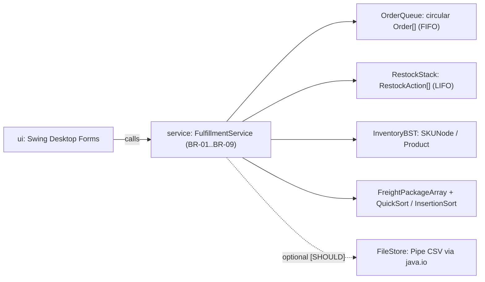
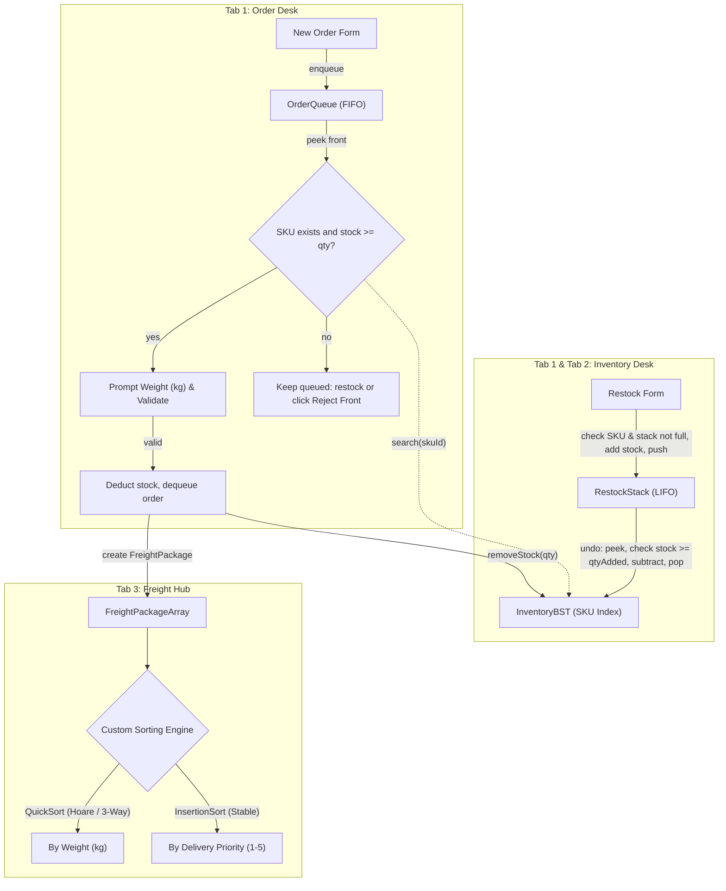
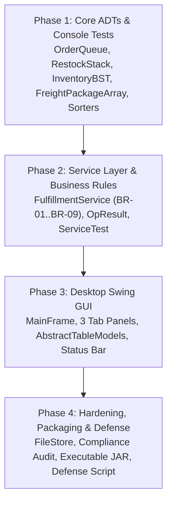

# 📦 E-Commerce Fulfillment & Logistics System (Group 1)
**BSIS 2nd Year — Data Structures & Algorithms | 3-Week Final Laboratory Project**  
*Java 17 LTS · Desktop Swing GUI (IntelliJ UI Designer / NetBeans) · Primitive Custom Data Structures · Standalone Executable JAR*

> **Document Status: Solo Architecture & Engineering Contract.** This `README.md` serves as the **single source of truth** for class names, package architecture, method contracts, business rules, compliance standards, and defense expectations. Scope items are tagged **[MUST]**, **[SHOULD]**, or **[COULD]**. Complete test cases and run logs live in `TEST_PLAN.md`.

---

## Grading Rubric & Deliverable Traceability (100 Points)

| Rubric Category | Weight | Target Implementation | Verification Artifact |
| :--- | :---: | :--- | :--- |
| **Desktop GUI & Usability** | 15 pts | 3-tab Swing desktop interface; non-editable `AbstractTableModel` tables; live status bar; friendly `JOptionPane` input validation dialogs | `MainFrame`, 3 tab panels, `TC-G01..G09`, `TC-V01..V06` |
| **Linear ADTs (Queue & Stack)** | 20 pts | Primitive circular array `OrderQueue` (FIFO order dispatch) and primitive array `RestockStack` (LIFO restock history + safe Undo); zero Java Collections | `OrderQueue`, `RestockStack`, `LinearADTTest`, `TC-Q01..Q10`, `TC-ST01..ST08` |
| **Hierarchical BST Indexing** | 25 pts | Custom `SKUNode` + `InventoryBST` keyed by numeric `skuId`: recursive insertion, target search, in-order catalog display, and complete 3-case deletion (Leaf, 1 Child, 2 Children via In-Order Successor) | `Product`, `SKUNode`, `InventoryBST`, `BSTTest`, `TC-B01..B21` |
| **Custom Sorting Engine** | 15 pts | Two distinct custom sorters from scratch: **QuickSort** by Weight (kg) and **InsertionSort** by Delivery Priority, wired to buttons and dynamic column-header clicks | `QuickSort`, `InsertionSort`, `FreightPackageArray`, `SortTest`, `TC-SO01..SO13` |
| **Executable JAR & Code Quality** | 15 pts | Double-clickable standalone `.jar` targeting Java 17 (`major version: 61`); modular 3-tier OOP architecture; comprehensive Javadoc/inline comments; zero prohibited imports | `dist/LogisticsHub.jar`, `COMP-01..COMP-06` |
| **Documentation & Live Defense** | 10 pts | Technical Documentation PDF (System Overview, UML Class Diagrams, Algorithm Flowcharts, User Guide) + rehearsed 10-minute solo live system demonstration and Q&A | `Group1_Technical_Documentation.pdf`, `COMP-07`, §9 Defense Script |

---

## 1. System Plan & Architecture

### 1.1 Real-World Domain
This desktop application simulates a centralized **E-Commerce Fulfillment & Logistics Hub** (modeling warehouse operations at Shopee or Lazada). One unified operator workflow ties all three required DSA modules together:

1. **Order Desk & Restock Audit (Module 1 — Queue & Stack):** Incoming customer orders wait in a FIFO circular queue (`OrderQueue`); warehouse restock shipments are logged on a LIFO stack (`RestockStack`) so mistaken stock entries can be safely reversed via Undo.
2. **SKU Catalog Index (Module 2 — Binary Search Tree):** All products are indexed by unique numeric `skuId` in a custom `InventoryBST` supporting fast $O(\log n)$ lookup, sorted in-order table display, and safe 3-case deletion.
3. **Freight Logistics Hub (Module 3 — Sorting Engine):** Every successfully dispatched order creates a packed `FreightPackage` stored in a custom primitive dynamic array (`FreightPackageArray`), dynamically re-ordered by weight (**QuickSort**) or delivery priority (**InsertionSort**).

### 1.2 Three-Tier Architecture



**Golden Rule:** Swing event handlers and table models **never** mutate `OrderQueue`, `RestockStack`, `InventoryBST`, or `FreightPackageArray` directly. Every UI action calls `FulfillmentService`, which validates business rules and returns an `OpResult(boolean success, String message)`. This guarantees:
- All business logic (`BR-01` to `BR-09`) can be thoroughly verified in console test suites without launching Swing.
- UI components stay lightweight, declarative, and focused exclusively on rendering and user feedback.
- Clean separation of concerns makes solo development and rapid iteration fast, modular, and bug-free.

### 1.3 End-to-End Data Flow



### 1.4 Business Rules Contract (BR-01 to BR-09)

| Rule ID | Contract |
| :--- | :--- |
| **BR-01** | `skuId` is a unique positive integer (`>= 1`); inserting an existing SKU is rejected. *(Note: The course specification states the general BST invariant `left <= root < right`; because warehouse SKUs must be unique, our catalog strictly enforces `left < root < right`. Document this justification in the final PDF.)* |
| **BR-02** | Every order requires an existing `skuId`, `quantity >= 1`, non-blank `customerName` and `destination` (no `\|` character), and `deliveryPriority` from **1 to 5** (`1 = Express`, `2 = Priority`, `3 = Standard`, `4 = Economy`, `5 = Bulk Saver`). |
| **BR-03** | **Dispatch is Peek -> Validate -> Commit.** An order leaves `OrderQueue` only after SKU existence, available stock, and parcel weight all validate—or when the operator explicitly clicks **Reject Front Order** (logged as `REJECTED`). |
| **BR-04** | Product `stockQty` is never negative (`>= 0`), enforced inside `Product.addStock(int)` and `Product.removeStock(int)`. |
| **BR-05** | **Restock is atomic:** verify the SKU exists in `InventoryBST` and `!restockStack.isFull()` *before* increasing stock. If either check fails, nothing changes. |
| **BR-06** | **Safe Undo (Anti-Lost-Update):** Peek the top `RestockAction` and **subtract `quantityAdded` from current stock**—never restore an old stock snapshot (which would erase sales dispatched after the restock). If `currentStock < quantityAdded`, refuse undo and keep the entry on the stack. If the SKU was deleted, discard the entry with a warning. |
| **BR-07** | Deleting a SKU requires user confirmation. Queued orders referencing a deleted SKU are caught at dispatch and flagged as `"SKU discontinued"`. |
| **BR-08** | A `FreightPackage` is created only by a successful dispatch. Weight must be a finite number (`!Double.isNaN`, `!Double.isInfinite`) within `0.01 - 1000.00 kg`; `destination` and `deliveryPriority` copy from the dispatched order. |
| **BR-09** | Sorting operates exclusively on `FreightPackageArray` and the Freight table; it never alters `InventoryBST`. |

### 1.5 Scope Priorities

| Priority | Deliverables |
| :--- | :--- |
| **[MUST]** | `OrderQueue`, `RestockStack`, `InventoryBST` (recursive insert, search, in-order, 3-case delete), `FreightPackageArray`, Hoare/3-Way `QuickSort`, stable `InsertionSort`, `FulfillmentService`, 3-tab Swing GUI, input validation, standalone Executable JAR verified on a clean JRE 17+ PC, Technical Documentation PDF, 10-minute defense rehearsal |
| **[SHOULD]** | Column-header sorting via `MouseAdapter`, pipe-delimited CSV `FileStore` with balanced seed data and ID counter sync, live status bar (`Queue · Restock Log · Catalog SKUs/Height · Packages`), rejected-orders log |
| **[COULD]** | Visual BST height/structure preview panel; display-copy catalog sorting by price or stock |

---

## 2. Project Layout & Class Responsibilities

### 2.1 Package Structure
Base package: `com.group1.logistics` (no classes in the default package).

```text
src/com/group1/logistics/
├── Main.java                            <-- entry point; sets Look & Feel, launches MainFrame on EDT
├── models/
│   ├── Product.java                     <-- skuId, name, price (PHP), stockQty (+ stock guards)
│   ├── Order.java                       <-- orderId, customerName, skuId, quantity, destination, deliveryPriority, sequenceNo
│   ├── RestockAction.java               <-- actionId, skuId, quantityAdded, sequenceNo
│   └── FreightPackage.java              <-- packageId, orderId, destination, weightKg, deliveryPriority, sequenceNo
├── datastructures/
│   ├── OrderQueue.java                  <-- primitive circular Order[] queue (FIFO)
│   ├── RestockStack.java                <-- primitive RestockAction[] stack (LIFO)
│   ├── SKUNode.java                     <-- wraps Product + left, right pointers
│   ├── InventoryBST.java                <-- recursive insert, search, inOrder(), 3-case delete, size, height
│   └── FreightPackageArray.java         <-- primitive dynamic FreightPackage[] with manual doubling
├── sorting/
│   ├── SortCriteria.java                <-- custom compare interface (NOT java.util.Comparator)
│   ├── PackageCriteria.java             <-- BY_WEIGHT, BY_PRIORITY, BY_ID
│   ├── QuickSort.java                   <-- Hoare or 3-Way QuickSort + median-of-three + tail-call optimization
│   └── InsertionSort.java               <-- stable in-place shifting sort
├── service/
│   ├── FulfillmentService.java          <-- central coordinator owning all 4 structures; enforces BR-01..BR-09
│   └── OpResult.java                    <-- success flag + user-facing message
├── io/
│   └── FileStore.java                   <-- pipe-delimited CSV load/save via java.io only [SHOULD]
└── ui/
    ├── MainFrame.java                   <-- JFrame: JTabbedPane + live status bar
    ├── OrdersPanel.java                 <-- Tab 1: Orders (Place Order, Queue, Ship/Cancel)
    ├── CatalogPanel.java                <-- Tab 2: Products (Register Product, Find, In-Order Table, Delete)
    ├── RestockPanel.java                <-- Tab 3: Restock (Add Stock, History, Safe Undo)
    ├── FreightPanel.java                <-- Tab 4: Shipments (Sorting Controls, Header Clicks)
    └── (4 AbstractTableModel subclasses: QueueTableModel, RestockTableModel, CatalogTableModel, FreightTableModel)

test/com/group1/logistics/               <-- console unit/service tests (excluded from JAR)
├── LinearADTTest.java
├── BSTTest.java
├── SortTest.java
└── ServiceTest.java
```

### 2.2 Class Responsibilities

| Class | Key Members | Responsibility |
| :--- | :--- | :--- |
| **`Product`** | `skuId`, `name`, `price`, `stockQty`; `addStock(n)`, `removeStock(n)` | Catalog record priced in PHP (`₱`); enforces `BR-04` (`stockQty >= 0`). |
| **`Order`** | `orderId`, `customerName`, `skuId`, `quantity`, `destination`, `deliveryPriority` (1-5), `sequenceNo` | Queue item; auto-generated IDs prevent collisions. |
| **`RestockAction`** | `actionId`, `skuId`, `quantityAdded`, `sequenceNo` | Stack item; stores `quantityAdded` for safe subtraction undo (`BR-06`). |
| **`FreightPackage`** | `packageId`, `orderId`, `destination`, `weightKg`, `deliveryPriority`, `sequenceNo` | Parcel created upon successful dispatch (`BR-08`). |
| **`OrderQueue`** | `Order[] elements`, `front`, `rear`, `count`, `capacity` | Concrete circular array FIFO. `get(i)` returns `elements[(front + i) % capacity]` so UI tables show logical order after wrap-around. |
| **`RestockStack`** | `RestockAction[] elements`, `top`, `capacity` | Concrete array LIFO (`top = -1` when empty). `get(i)` returns `elements[top - i]` so the audit table shows newest entries first. |
| **`SKUNode`** | `Product product`, `SKUNode left`, `SKUNode right` | BST node wrapping `Product` so tree pointers never leak to the UI layer. |
| **`InventoryBST`** | `SKUNode root`, `int size` | Recursive `insert`, `search`, `inOrder()` returning `Product[]`, 3-case `delete`, `size()`, `height()`. |
| **`FreightPackageArray`** | `FreightPackage[] data`, `int count` | Primitive resizable array (initial capacity 16, doubles manually via loop/`System.arraycopy`) replacing `ArrayList`. |
| **`SortCriteria`** | `int compare(FreightPackage a, FreightPackage b)` | Custom comparison contract replacing `java.util.Comparator`. |
| **`QuickSort`** / **`InsertionSort`** | `static void sort(FreightPackage[] arr, int count, SortCriteria c, boolean asc)` | Custom sorting algorithms operating strictly on active indices `0 .. count - 1`. |
| **`FulfillmentService`** | `enqueueOrder`, `dispatchNext`, `rejectFront`, `restock`, `undoRestock`, `addProduct`, `findProduct`, `deleteProduct`, `sortPackages`, `syncNextIds` | Central business-logic coordinator enforcing `BR-01..BR-09`. |
| **`OpResult`** | `boolean success`, `String message` | Standardized response object for UI dialogs and status feedback. |
| **`FileStore`** | `load(service)`, `save(service)`, `loadSeedData(service)` | Optional `java.io` CSV persistence + balanced-order seed dataset `[SHOULD]`. |

---

## 3. Locked Method Contracts

These concrete method signatures guarantee clean compilation and airtight modularity across the system:

```java
// Module 1: OrderQueue
public boolean enqueue(Order order);        // false if order == null or isFull()
public Order dequeue();                     // null if isEmpty(); sets freed slot to null
public Order peek();                        // null if isEmpty()
public Order get(int logicalIndex);         // elements[(front + logicalIndex) % capacity]
public int size();
public int capacity();
public boolean isEmpty();
public boolean isFull();

// Module 1: RestockStack
public boolean push(RestockAction action);  // false if action == null or isFull()
public RestockAction pop();                 // null if isEmpty(); sets freed slot to null
public RestockAction peek();                // null if isEmpty()
public RestockAction get(int indexFromTop); // elements[top - indexFromTop]
public int size();
public int capacity();
public boolean isEmpty();
public boolean isFull();

// Module 2: InventoryBST
public boolean insert(Product product);     // false if product == null, skuId <= 0, or duplicate
public Product search(int skuId);           // null if not found
public boolean delete(int skuId);           // 3-case delete; decrements size ONCE per removed node
public Product[] inOrder();                 // returns Product[size()] sorted ascending by skuId
public int size();
public int height();

// Module 3: FreightPackageArray & Sorting Engine
public void add(FreightPackage pkg);        // doubles backing array manually if count == data.length
public FreightPackage get(int index);
public FreightPackage[] rawArray();         // backing array for in-place sorting over 0 .. size() - 1
public int size();

public interface SortCriteria {
    int compare(FreightPackage a, FreightPackage b);
}
public static void QuickSort.sort(FreightPackage[] arr, int count, SortCriteria c, boolean asc);
public static void InsertionSort.sort(FreightPackage[] arr, int count, SortCriteria c, boolean asc);
```

---

## 4. Strict Technical Constraints & Compliance Audit

### 4.1 Prohibited Frameworks & Shortcuts
- **Java Collections Framework (Forbidden):** `ArrayList`, `LinkedList`, `Vector`, `HashMap`, `TreeMap`, `HashSet`, `TreeSet`, `Queue`, `Deque`, `PriorityQueue`, `Stack`
- **Built-in Sorting & Utilities (Forbidden):** `Arrays.sort()`, `Collections.sort()`, `Arrays.copyOf/fill`, `java.util.Comparator`, `java.util.Random`, `java.util.Objects`, `Optional`, Java Streams (`.stream()`), `List.of`, `Map.of`
- **Swing Auto-Sorters (Forbidden):** `TableRowSorter`, `setAutoCreateRowSorter(true)` (these bypass our custom sorting engine)
- **External Libraries (Forbidden):** No third-party JARs (FlatLaf, MigLayout, JUnit in shipped code) unless explicitly approved in writing by the instructor

### 4.2 Permitted Library Whitelist
Per `FINAL-Project-Guide (1).pdf`, only these libraries are permitted:
- `java.lang.*` (implicit; includes `System.arraycopy`, `Math`, `Double.isNaN`, `Double.isInfinite`)
- `java.io.*` (for optional CSV persistence in `FileStore`)
- `javax.swing.*` and `java.awt.*` (standard desktop GUI libraries)
- `java.util.Scanner` (console debugging/tests only — kept inside `test/`)
- *Timestamps note:* Do **not** import `java.time.*` or `java.text.*` unless confirmed in writing by the instructor; display `Seq #1, Seq #2, ...` (`sequenceNo`) in audit and freight tables instead.

### 4.3 Implementation Substitution Matrix

| Need | Prohibited | Required Custom Implementation |
| :--- | :--- | :--- |
| Resizable package list | `ArrayList<FreightPackage>` | `FreightPackageArray` with manual capacity doubling (`System.arraycopy` or loop) |
| Order line (FIFO) | `java.util.Queue<Order>` | `OrderQueue` circular `Order[]` with `(index + 1) % capacity` |
| Undo history (LIFO) | `java.util.Stack<RestockAction>` | `RestockStack` primitive `RestockAction[]` with `top` pointer (`-1` empty) |
| SKU Catalog index | `java.util.TreeMap<Integer, Product>` | `InventoryBST` with `SKUNode` objects and explicit `left`/`right` references |
| Comparison logic | `java.util.Comparator<T>` | Custom `SortCriteria` interface |
| Table sorting | `Arrays.sort()` / `TableRowSorter` | Custom `QuickSort` + `InsertionSort` triggered via buttons and `JTableHeader` `MouseAdapter` |

### 4.4 Automated Compliance & Bytecode Checks (PowerShell)
Run both commands before every release and before final submission:

```powershell
# 1. Confirm ZERO forbidden imports or Swing RowSorter calls (only Scanner in test/ allowed)
Get-ChildItem -Path src,test -Recurse -Filter *.java |
  Select-String -Pattern 'java\.util|java\.time|java\.text|Arrays\.|Collections\.|\.stream\(|List\.of|Map\.of|RowSorter|setAutoCreateRowSorter'

# 2. Confirm compiled JAR bytecode targets Java 17 (expect: major version: 61)
javap -v -cp dist\LogisticsHub.jar com.group1.logistics.Main | Select-String "major version"
```

---

## 5. Module Specifications & Engineering Safeguards

### 5.1 Module 1: Linear ADTs (`OrderQueue` & `RestockStack`)
- **Concrete Typed Arrays:** Use `Order[]` and `RestockAction[]` rather than `(T[]) new Object[capacity]` to avoid Java generic array type-erasure bugs and unchecked-cast warnings.
- **OrderQueue (Capacity 20):** O(1) `enqueue`, `dequeue`, and `peek` using circular modulo arithmetic (`(rear + 1) % capacity` and `(front + 1) % capacity`). Reject `null`, guard overflow/underflow, clear dequeued slots to `null`, and implement `get(i)` in logical FIFO order.
- **RestockStack (Capacity 20):** O(1) `push`, `pop`, and `peek` with `top = -1` when empty. Clear popped slots to `null`. Enforce atomic restocking (`BR-05`) and subtraction-based safe undo (`BR-06`) inside `FulfillmentService`.

### 5.2 Module 2: Hierarchical Indexing Engine (`InventoryBST`)
- **Recursive Insertion:** Return updated subtree roots; reject duplicate or non-positive `skuId` (`BR-01`) and increment `size` only on actual insertion.
- **Target Search:** Average O(log n), worst O(n) if degenerate. Update product stock directly via the returned `Product` reference rather than deleting and re-inserting.
- **In-Order Traversal (`Left -> Node -> Right`):** Allocates `new Product[size]` and populates via a helper using a 1-element `int[] idx = { 0 }` counter so the catalog table is always strictly ascending by `skuId`.
- **3-Case Deletion (Critical Safeguards):**
  - *Case 1 (Leaf):* return `null`.
  - *Case 2 (One child):* return the non-null child.
  - *Case 3 (Two children):* find the **in-order successor** (leftmost node in `node.right`), copy its `Product` into `node.product`, and recursively delete `successor.product.getSkuId()` from `node.right`. Because the successor can itself have a right child, reusing Case 1/2 deletion handles it automatically.
  - **Double-Decrement Guard:** Never decrement `size` before branching into Case 3—otherwise `size` decrements twice (once at the target node, once when deleting the successor) and crashes `inOrder()` with `ArrayIndexOutOfBoundsException`. Decrement `size` **only** inside Case 1/Case 2 unlinking (or once in the public `delete()` wrapper via `boolean[] deleted`).
- **Balanced Startup Seed Order:** Insert demo SKUs in balanced order (e.g., `500, 300, 700, 200, 400, 600, 800, 150, 250, 350, 450, 550, 650, 750`) so initial tree height is 4 instead of degenerating into a linked list.

### 5.3 Module 3: Custom Sorting Engine (`QuickSort` & `InsertionSort`)
- **QuickSort (By Weight — Average O(n log n)):**
  - **Do NOT use Lomuto partitioning.** Even with median-of-three pivots, Lomuto degrades to O(n) recursion depth on all-equal weights (causing `StackOverflowError` at 20,000 items).
  - Use **Hoare partitioning** (or **3-Way Dutch National Flag partitioning**) with **median-of-three** pivot selection (no `Random`) and **tail-call elimination** (recurse on the smaller partition, loop on the larger) to guarantee O(log n) stack depth on sorted, reverse-sorted, and all-equal inputs.
  - Apply an always-ascending `sequenceNo` tie-breaker inside `QuickSort` (do not flip the tie-breaker sign on descending sort).
- **InsertionSort (By Delivery Priority — Best O(n), Average/Worst O(n^2), Stable):**
  - Compare **only** `deliveryPriority` (do not bake `sequenceNo` into a negated descending comparator) and shift only on strict inequality (`>` ascending, `<` descending). This guarantees equal-priority parcels keep their FIFO arrival order in **both** ascending and descending modes.
- **Bounds Safety:** Both sorters must handle `count <= 1` cleanly and only sort indices `0 .. count - 1`.

### 5.4 Desktop GUI, Custom Tables & Domain Standards
- Launch `MainFrame` inside `SwingUtilities.invokeLater`, set system Look & Feel, and use `EXIT_ON_CLOSE` so no background Java process lingers on window close.
- **3 Tabs + Status Bar:**
  1. *Orders & Restock Hub:* Order entry form, FIFO queue table, **Dispatch Next** (prompts weight), **Reject Front Order**, Restock form, **Undo Last Restock**, newest-first audit table.
  2. *SKU Catalog Index (BST):* Register SKU form, Search bar populating read-only detail fields, In-Order `JTable`, **Delete SKU** with confirmation dialog.
  3. *Freight Logistics Hub:* Parcel manifest table, **Sort by Weight (QuickSort)**, **Sort by Priority (InsertionSort)**, Asc/Desc toggle, active-sort label (`Sorted by Weight · QuickSort · Ascending`), and clickable column headers.
  - *Bottom Status Bar:* `Queue 3/20 · Restock Log 2 · Catalog 14 SKUs (Height 4) · Packages 6`.
- **Table Model & Header-Click Compliance:** Extend `AbstractTableModel` for all four tables (avoid `DefaultTableModel`, which uses `Vector` internally). Keep cells non-editable (`isCellEditable` returns `false`). Call `table.setAutoCreateRowSorter(false)` and `table.getTableHeader().setReorderingAllowed(false)`. Attach a `MouseAdapter` to `table.getTableHeader()` calling `table.columnAtPoint(e.getPoint())`, invoking `FulfillmentService.sortPackages(...)`, and firing `fireTableDataChanged()`.
- **Consistent Localization & Demo Data:** Display prices in Philippine Pesos (`₱`), route freight to Metro Manila hubs (`Quezon City Hub`, `Manila Central Hub`, `Makati Logistics Hub`, `Pasig Cargo Depot`), and use neutral fictional customer names (`Juan Dela Cruz`, `Maria Santos`, `Ana Reyes`, `Carlo Mendoza`).

---

## 6. Persistence (`FileStore`) [SHOULD]
- Uses `java.io.*` only (`BufferedReader`, `FileReader`, `BufferedWriter`, `FileWriter`, try-with-resources).
- Stores pipe-delimited (`|`) files (`products.csv`, `orders.csv`, `packages.csv`) inside `System.getProperty("user.home") + "/LogisticsHub"`; input validation rejects `|` in text fields.
- On startup, loads saved files and calls `service.syncNextIds(maxOrderId, maxPackageId, maxSeq)` so newly created orders/packages never collide with reloaded IDs. If files are missing or unreadable, loads balanced built-in seed data and skips corrupted lines gracefully.
- Restock undo history is session-only (document this clearly in the User Guide).

---

## 7. Build & Executable JAR Guide

### In IntelliJ IDEA
1. **File -> Project Structure -> Project** -> set SDK & Language Level to **17**.
2. **Project Structure -> Artifacts -> `+` -> JAR -> From modules with dependencies** -> select Main Class `com.group1.logistics.Main`.
3. Select **Build -> Build Artifacts -> Build** and verify the output `.jar` via double-click.

### In NetBeans IDE
1. Right-click Project -> **Properties -> Sources** -> set **Source/Binary Format** to **JDK 17**.
2. **Properties -> Run** -> set **Main Class** to `com.group1.logistics.Main`.
3. Select **Run -> Clean and Build** -> executable JAR is generated in `dist/LogisticsHub.jar`.

### Command Line (PowerShell)
```powershell
# Compile main sources targeting Java 17
javac --release 17 -encoding UTF-8 -d bin (Get-ChildItem -Path src -Recurse -Filter *.java | ForEach-Object { $_.FullName })

# Compile and run console unit & service tests (kept out of JAR)
javac --release 17 -encoding UTF-8 -d bin-test -cp bin (Get-ChildItem -Path test -Recurse -Filter *.java | ForEach-Object { $_.FullName })
java -cp "bin;bin-test" com.group1.logistics.LinearADTTest
java -cp "bin;bin-test" com.group1.logistics.BSTTest
java -cp "bin;bin-test" com.group1.logistics.SortTest
java -cp "bin;bin-test" com.group1.logistics.ServiceTest

# Package standalone executable JAR
jar cfe LogisticsHub.jar com.group1.logistics.Main -C bin .
java -jar LogisticsHub.jar
```
Include a helper `run.bat` (`java -jar LogisticsHub.jar` + `pause`) in your test folder during rehearsal so any runtime error remains visible.

---

## 8. Solo Development Roadmap & Milestones

Building this project solo with Antigravity + IntelliJ gives you complete architectural consistency. Follow this phased progression:



### Phase-by-Phase Roadmap
- **Phase 1 (Core Data Structures & Algorithmic Unit Tests):**
  - Implement `OrderQueue` (circular FIFO) and `RestockStack` (LIFO). Test wrap-around and limits in `LinearADTTest`.
  - Implement `SKUNode` and `InventoryBST` (recursive insert, search, in-order `Product[]`, and 3-case deletion with the double-decrement guard). Test in `BSTTest`.
  - Implement `FreightPackageArray`, Hoare/3-Way `QuickSort`, and stable `InsertionSort`. Test in `SortTest`.
- **Phase 2 (Service Layer & Business Logic):**
  - Implement `FulfillmentService` enforcing rules `BR-01` through `BR-09` (atomic restock, safe subtraction undo, peek-validate-commit dispatch).
  - Verify complete workflow logic without Swing via `ServiceTest`.
- **Phase 3 (Desktop Swing GUI & Event Integration):**
  - Build `MainFrame` and the 4 dedicated tab panels (`OrdersPanel`, `CatalogPanel`, `RestockPanel`, `FreightPanel`).
  - Create the four `AbstractTableModel` subclasses and wire all button actions and header clicks to `FulfillmentService`.
- **Phase 4 (Persistence, Compliance, JAR Packaging & Defense Prep):**
  - Add optional pipe-delimited CSV `FileStore` with balanced seed data.
  - Run the PowerShell `COMP-01` compliance scan to verify zero prohibited imports.
  - Export and test `LogisticsHub.jar` on a clean PC without an IDE.
  - Export `Group1_Technical_Documentation.pdf` and rehearse the 10-minute solo presentation.

---

## 9. Submission Checklist & Solo Defense Script

### 9.1 Final Submission Package (NEU-VLE)
- [ ] **Executable JAR (`LogisticsHub.jar`):** Verified Java 17 (`major version: 61`); double-clicks cleanly on a separate PC with no IDE open.
- [ ] **Source Code Archive (`Group1_SourceCode.zip`):** Contains full project folder including all `.java` files, GUI forms, and project configuration; fresh extract builds cleanly.
- [ ] **Technical Documentation (`Group1_Technical_Documentation.pdf`):** Contains System Overview, `BR-01` duplicate-SKU note, UML Class Diagrams, 4 Algorithm Flowcharts (Dispatch, Restock/Undo, 3-Case BST Deletion, QuickSort Partitioning), and User Guide with `₱` screenshots.
- [ ] **Compliance Audit Passed:** PowerShell `COMP-01` scan returns zero prohibited imports or `RowSorter` references.
- [ ] **Upload Verified:** Final zip uploaded to NEU-VLE, re-downloaded, extracted, and launched successfully.

### 9.2 10-Minute Solo Live Defense Script

As the sole presenter, you walk through the system with complete technical mastery:

| Time | Action | Demonstration Focus |
| :---: | :--- | :--- |
| **0:00 - 1:00** | **App Launch & Overview** | Double-click the standalone `.jar` on the desktop with no IDE open. Introduce the 3-tier architecture (`UI` $\rightarrow$ `FulfillmentService` $\rightarrow$ `Custom ADTs`), live status bar, and zero-collections compliance. |
| **1:00 - 3:30** | **Module 2: BST Demonstration** | Open Tab 2. Point out that the catalog table is populated strictly via **In-Order Traversal** (`Left -> Root -> Right`). Demonstrate $O(\log n)$ **Target Search**. Execute a **Case 1 (Leaf)** deletion, then a **Case 3 (Two Children)** deletion, explaining how the In-Order Successor takes its place and `size` is cleanly guarded against double-decrementing. |
| **3:30 - 6:00** | **Module 1: Queue & Stack Demonstration** | Open Tab 1. Enqueue orders to showcase circular FIFO buffering. Click **"Dispatch Next"**, enter parcel weight, and show the atomic peek-validate-commit transition (`BR-03`). Trigger an **Insufficient Stock** warning to show stock protection. Restock an item, then click **"Undo Last Restock"** to demonstrate subtraction-based LIFO rollback (`BR-06`). |
| **6:00 - 7:30** | **Module 3: Sorting Engine Demonstration** | Open Tab 3. Show unsorted packages. Click **"Sort by Weight"** and explain the Hoare/3-Way QuickSort partition ($O(n \log n)$). Click **"Sort by Priority"** and explain how InsertionSort stability preserves FIFO arrival order for equal-priority items. Click column headers to show dynamic sorting without `TableRowSorter`. |
| **7:30 - 8:30** | **Code Quality & Compliance Audit** | Walk through UML Class Diagram and flowcharts. Run the live PowerShell `COMP-01` regex scan on screen to prove **zero prohibited imports**. |
| **8:30 - 10:00** | **Panel Q&A Defense** | Confidently answer the panel's questions on time complexity, algorithmic trade-offs, and data structure mechanics. |

### 9.3 Defense Q&A Quick Reference

| Expected Question | Concise Technical Answer |
| :--- | :--- |
| Why a circular array for `OrderQueue`? | Modulo indexing `(index + 1) % capacity` reuses freed front slots without shifting elements, keeping `enqueue` and `dequeue` O(1). |
| What is the BST's worst case? | O(n) when keys arrive in sorted order (degenerate chain); average is O(log n). We seed demo SKUs in balanced order and note AVL balancing as the theoretical fix. |
| Why use the in-order successor in Case 3 deletion? | It is the smallest key in the right subtree—strictly greater than the left subtree and smaller than all remaining right-subtree nodes—preserving BST ordering. |
| What if the in-order successor has a child? | As the leftmost node in the right subtree, it cannot have a left child—only at most a right child—so Case 1/2 deletion unlinks it cleanly. We also guard `size` so Case 3 decrements it only once. |
| Why Hoare or 3-Way partitioning for QuickSort? | Standard Lomuto partitioning degrades to O(n) stack depth on all-equal weights even with median-of-three; Hoare/3-Way plus tail-call elimination keeps recursion depth O(log n). |
| Why InsertionSort for delivery priority? | InsertionSort is **stable** and O(n) on nearly sorted data; by comparing only the primary priority key, equal-priority parcels keep their arrival order in both Asc and Desc modes. |
| Why does Undo subtract `quantityAdded` instead of restoring old stock? | Restoring a saved stock snapshot would erase orders dispatched after the restock (lost-update bug). Subtracting preserves sales and safely blocks undo if units already shipped. |
| How do you guarantee zero Java Collections or `TableRowSorter` usage? | We use concrete primitive arrays, `FreightPackageArray`, custom `SortCriteria`, `AbstractTableModel`, and header `MouseAdapter` listeners, verified via our PowerShell `COMP-01` regex audit. |
