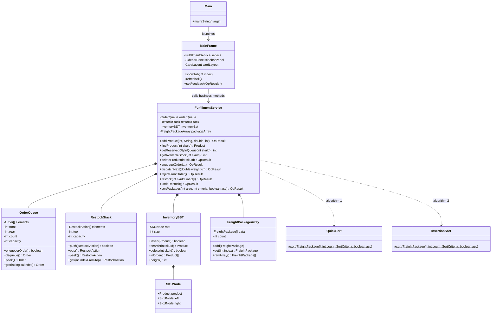
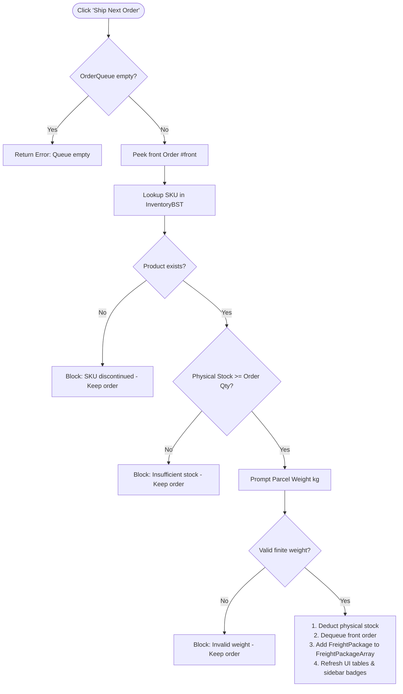
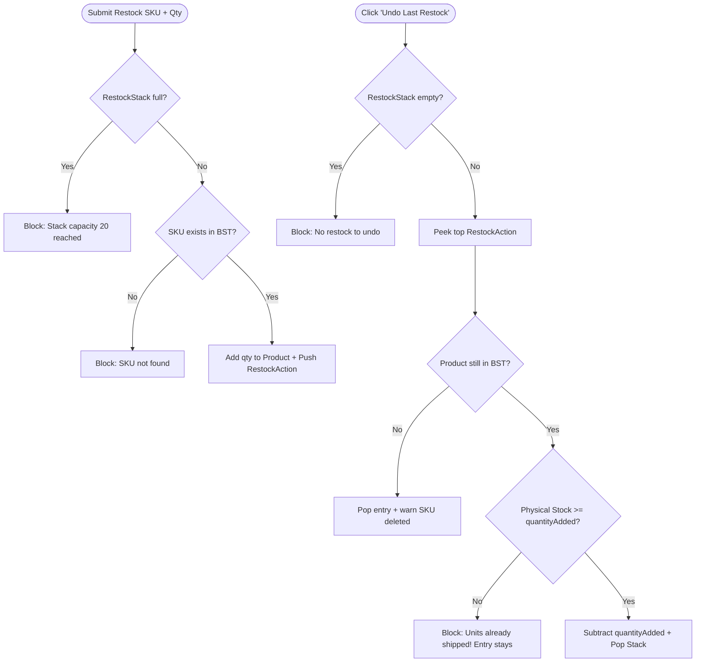
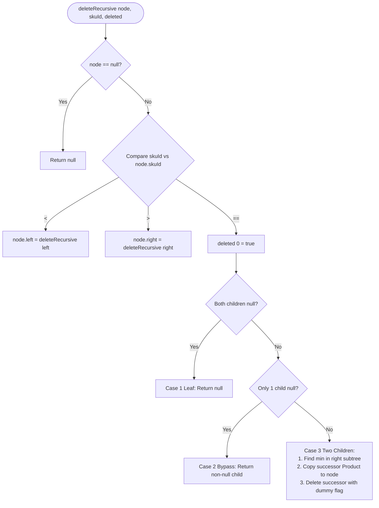
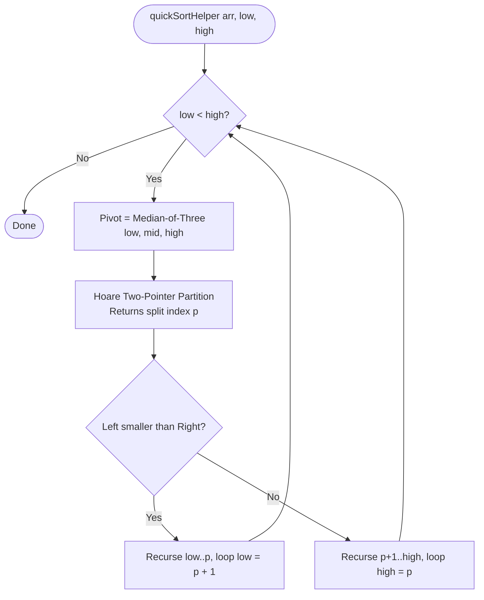
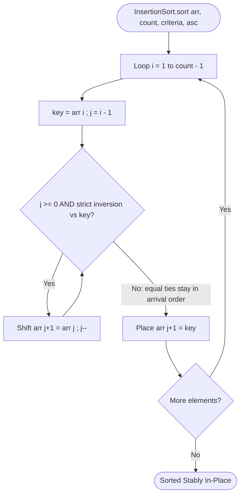

# Order & Shipping Manager — Logistics Hub
## Complete Technical Documentation & Plain-English System Guide

**Course:** BSIS 2nd Year — Data Structures & Algorithms (DSA)  
**Project:** Group 1 — E-Commerce Fulfillment & Logistics System  
**Platform:** Java 17 LTS · Standard Java Swing / AWT / Java 2D · Zero Third-Party Libraries · Zero Java Collections  

---

## Table of Contents
1. [Chapter 1: Plain-English Overview & Purpose](#chapter-1-plain-english-overview--purpose)
2. [Chapter 2: System Architecture & Tech Stack](#chapter-2-system-architecture--tech-stack)
3. [Chapter 3: Core Data Structures & Algorithms Explained](#chapter-3-core-data-structures--algorithms-explained)
4. [Chapter 4: Business Rules Contract & Live Stock Reservation](#chapter-4-business-rules-contract--live-stock-reservation)
5. [Chapter 5: UML Class Diagram & Algorithm Flowcharts](#chapter-5-uml-class-diagram--algorithm-flowcharts)
6. [Chapter 6: Complete User Guide (Step-by-Step Manual)](#chapter-6-complete-user-guide-step-by-step-manual)
7. [Chapter 7: Testing, Compliance Verification & Team Defense Guide](#chapter-7-testing-compliance-verification--team-defense-guide)

---

# Chapter 1: Plain-English Overview & Purpose

### 1.1 What Is This Application?
**Order & Shipping Manager — Logistics Hub** is a standalone offline desktop application built for an e-commerce warehouse (such as Shopee, Lazada, or Amazon fulfillment centers). It gives a warehouse operator one place to track products in stock, queue customer orders fairly, pack and ship parcels, log incoming restocks (with an Undo safety net), and organize shipped boxes for delivery vans.

### 1.2 Why Does It Matter?
Without organized data structures behind a warehouse screen, everyday mistakes happen quickly:
- **Unfair order processing:** Late orders skip ahead of earlier customers if orders are not kept in strict First-In, First-Out (**FIFO**) arrival order.
- **Overselling stock:** Multiple pending orders can accidentally claim the same remaining items if queued reservations are ignored.
- **Slow catalog lookup:** Scanning every item one by one slows down as a product catalog grows to thousands of SKUs.
- **Accidental "Lost Updates" on Undo:** Typing `+500` instead of `+50` during restocking—and then blindly restoring an old stock snapshot after a sale—erases purchases made in between.
- **Unorganized delivery loading:** Delivery vans need parcels arranged quickly by **parcel weight** (heavy boxes at the bottom) or **delivery speed** (Express boxes loaded first while preserving original arrival order among ties).

### 1.3 Strict Technical Rules Satisfied
To demonstrate foundational Data Structures & Algorithms mastery under [`FINAL-Project-Guide (1).pdf`](DocsGuidelines/FINAL-Project-Guide%20(1).pdf):
1. **Java 17 LTS strictly** (`javac --release 17`).
2. **Zero external libraries:** No FlatLaf, MigLayout, Maven/Gradle, JUnit, or third-party JARs.
3. **Zero Java Collections Framework:** Zero imports of `java.util.*`, `java.time.*`, or `java.text.*` in `src/`. All ADTs (`OrderQueue`, `RestockStack`, `InventoryBST`, `FreightPackageArray`) and sorting algorithms (`QuickSort`, `InsertionSort`) are built from scratch using primitive arrays and object node references.
4. **Swing Table Compliance:** No `DefaultTableModel`, `TableRowSorter`, or `setAutoCreateRowSorter(true)`. Every table uses a custom non-editable `AbstractTableModel`, and shipment column headers invoke custom sorting via `MouseAdapter` listeners.
5. **Clean Architecture Separation:** UI screens in `com.group1.logistics.ui` interact exclusively through `FulfillmentService` and receive `OpResult` feedback objects—never mutating data structures directly.

---

# Chapter 2: System Architecture & Tech Stack

### 2.1 Layered Software Architecture
The codebase organizes **30 source classes** (`src/`) and **6 test suites** (`test/`) into clean layers:

| Layer | Package | Responsibility | Classes |
| :--- | :--- | :--- | :--- |
| **Entry Point** | `com.group1.logistics` | Initializes native OS Look & Feel and launches `MainFrame` on the Swing Event Dispatch Thread (EDT). | `Main` |
| **Desktop UI (View)** | `com.group1.logistics.ui` | Modern **App Shell** (`SidebarPanel` + `CardLayout` workspace + bottom toast strip), custom `AbstractTableModel` views, modal dialogs, and centralized `UiTheme` design system. | `MainFrame`, `SidebarPanel`, `UiTheme`, `OrdersPanel`, `CatalogPanel`, `RestockPanel`, `FreightPanel`, `QueueTableModel`, `CatalogTableModel`, `RestockTableModel`, `FreightTableModel`, `PlaceOrderDialog`, `AddProductDialog`, `AddStockDialog` |
| **Service Layer (Brain)** | `com.group1.logistics.service` | Central coordinator owning all 4 data structures, enforcing business rules `BR-01`–`BR-09`, atomic dispatch, safe undo, and live queued-stock calculations. | `FulfillmentService`, `OpResult` |
| **Custom ADTs** | `com.group1.logistics.datastructures` | From-scratch linear and hierarchical structures built purely with arrays and explicit node pointers. | `OrderQueue`, `RestockStack`, `InventoryBST`, `SKUNode`, `FreightPackageArray` |
| **Sorting Engine** | `com.group1.logistics.sorting` | Custom comparator interface (`SortCriteria`), package criteria, and two in-place sorting algorithms. | `SortCriteria`, `PackageCriteria`, `QuickSort`, `InsertionSort` |
| **Domain Models** | `com.group1.logistics.models` | Validated data entities with invariant guards (positive IDs, non-negative stock, bounded weights/priorities). | `Product`, `Order`, `RestockAction`, `FreightPackage` |
| **Verification (Tests)** | `com.group1.logistics` (`test/`) | Standalone Java console tests and high-volume performance benchmarks without external test frameworks. | `LinearADTTest`, `BSTTest`, `SortTest`, `ServiceTest`, `FullSystemCheckupTest`, `UltimatePerformanceTest` |

### 2.2 Frontend App Shell Organization
In industry UI/UX terminology, the frontend follows a **Modern SaaS / ERP Dashboard App Shell** pattern implemented cleanly in standard Swing + Java 2D (`Graphics2D`):
- **Left Navigation Sidebar (`SidebarPanel`, `220px` fixed navy rail `#0B1B33`):** Houses the vector Storefront brand badge, module buttons with live item count pills (`Orders`, `Products`, `Restock`, `Shipments`), and the **Technical details** checkbox.
- **Central Card Workspace (`CardLayout`):** Switches cleanly between the 4 module views (`OrdersPanel`, `CatalogPanel`, `RestockPanel`, `FreightPanel`), automatically refreshing tables on tab change (`MainFrame.showTab(index)`). **Products** opens by default at startup.
- **Bottom Notification Strip (`pnlFeedback`):** Displays color-coded `OpResult` feedback banners (neutral Ready, green Success, red Error/Blocked).
- **Centralized Design Tokens (`UiTheme`):** Stores fonts (`Segoe UI`), warm alabaster window background (`#F3F2EE`), surface cards (`#FFFFFF`), custom `VectorIcon` drawings (`STORE`, `SHIP`, `BOX`, `PLUS`, `WEIGHT`, `SPEED`, `SEARCH`, `REFRESH`, `DELETE`, `CANCEL`, `UNDO`, `CLOSE`), pill status renderers, and custom scrollbars (`BasicScrollBarUI`).

---

# Chapter 3: Core Data Structures & Algorithms Explained

### 3.1 Circular Array Queue (`OrderQueue`) — Module 1 (FIFO)
* **Real-World Role:** Holds incoming customer orders waiting to be packed and shipped (`#1001`, `#1002`, ...).
* **Rule:** **FIFO (First In, First Out)** — the customer who ordered first is always `NEXT` to ship.
* **How the Circular Carousel Works:**  
  Instead of shifting every remaining order left after removing element `0` (which wastes $O(n)$ time), `OrderQueue` uses a fixed `Order[20]` array with modular wrap-around indexing (`capacity = 20`):
  - **Enqueue:** `rear = (rear + 1) % capacity; elements[rear] = order; count++;` -> **$O(1)$**
  - **Dequeue:** `removed = elements[front]; elements[front] = null; front = (front + 1) % capacity; count--;` -> **$O(1)$**
  - **Logical Display (`get(logicalIndex)`):** `elements[(front + logicalIndex) % capacity]` keeps the UI table displaying orders strictly from `NEXT` (index `0`) down to the newest arrival, even after `rear` wraps back to physical index `0`.
* **Clean Startup State:** The app initializes `OrderQueue` empty (`0/20`) on startup so newly placed user orders immediately appear at the front as **`#1001 (NEXT)`**, without pre-reserved startup stock.

### 3.2 LIFO Audit Stack (`RestockStack`) — Module 1 (LIFO)
* **Real-World Role:** Records warehouse stock additions (`RestockAction`) and powers **Undo Last Restock**.
* **Rule:** **LIFO (Last In, First Out)** — like a spring-loaded stack of trays (`top = -1` when empty, capacity `20`).
* **Key Operations:**
  - **Push:** `elements[++top] = action;` -> **$O(1)$**
  - **Pop:** Reads `elements[top]`, nulls the vacated slot for garbage-collection hygiene, and executes `top--;` -> **$O(1)$**
  - **Newest-First Table View (`get(indexFromTop)`):** Returns `elements[top - indexFromTop]` so row `0` in **Restock** is always the most recent replenishment.
* **Anti-Lost-Update Safe Undo (`BR-06`):**  
  Never restores an old stock snapshot. Instead, `FulfillmentService.undoRestock()` peeks the top action and **subtracts `quantityAdded`** from current physical stock—only if `product.getStockQty() >= quantityAdded`. If units were already shipped, Undo is blocked cleanly and the audit entry remains on the stack.

### 3.3 Hierarchical Binary Search Tree (`InventoryBST` + `SKUNode`) — Module 2
* **Real-World Role:** Acts as the master product index keyed by unique numeric **Product Code (`skuId`)**.
* **BR-01 Invariant Note (`left < root < right`):**  
  While the general project specification mentions `left <= root < right`, warehouse SKU codes are canonical primary keys (`BR-01`). Therefore `InventoryBST` strictly enforces `left.skuId < root.skuId < right.skuId` and rejects duplicate SKU insertions cleanly without modifying tree size.
* **Core Operations:**
  - **Recursive Insertion (`insertRecursive`):** Single tree descent adding a leaf `SKUNode` only when `targetId != currentId`; tracks insertion via a `boolean[1]` flag so `size` never double-increments.
  - **Balanced Seed Insertion:** On startup, 14 products are inserted in a balanced sequence (`500, 300, 700, 200, 400, 600, 800, 150, 250, 350, 450, 550, 650, 750`) so initial **BST Height is `4`** rather than a degenerate linear chain of `14`.
  - **Iterative Target Search (`search`):** Navigates left or right in **$O(\log n)$ average time** and **$O(1)$ stack space**.
  - **In-Order Traversal (`inOrderRecursive`):** Visits **Left -> Node -> Right**, producing `Product[]` already sorted ascending by Product Code without running a separate sort.
  - **3-Case Node Deletion (`deleteRecursive`):**
    1. **Case 1 (Leaf Node):** `left == null && right == null` -> returns `null`.
    2. **Case 2 (One Child):** Returns the single non-null child (`current.right` or `current.left`).
    3. **Case 3 (Two Children):** Finds the **In-Order Successor** (`findMin(current.right)` — leftmost node in the right subtree), copies `successor.product` into `current`, and recursively deletes `successor` from `current.right` using a **dummy flag** (`Double-Decrement Guard`) so `size` decrements exactly once.
* **UI Performance Optimization:** `CatalogTableModel` caches formatted Peso prices (`₱`), lowercased names, net available stock, and stock KPI counts in a single `refresh()` pass; numeric search performs BST lookup + $O(\log n)$ binary row lookup (`findRowBySkuId`), while text search scans cached lowercased names with a `250 ms` Swing `Timer` debounce.

### 3.4 Dynamic Package Array & Custom Sorting Engine (`FreightPackageArray`, `QuickSort`, `InsertionSort`) — Module 3
* **Dynamic Storage (`FreightPackageArray`):** Replaces `java.util.ArrayList` using a primitive `FreightPackage[]` backing array (`initialCapacity = 16`). When `count == data.length`, `ensureCapacity()` allocates `data.length * 2` and copies via `System.arraycopy`.
* **Sorting Interface (`SortCriteria` & `PackageCriteria`):** Replaces `java.util.Comparator` via `@FunctionalInterface int compare(FreightPackage a, FreightPackage b)` with 4 criteria: `BY_WEIGHT`, `BY_PRIORITY`, `BY_ID`, and `BY_DESTINATION`.
* **Algorithm 1 — `QuickSort` (Weight & Package No.):**
  - **Hoare Partitioning** + **Median-of-Three Pivot Selection** (`low`, `mid`, `high`) prevents $O(n^2)$ behavior on pre-sorted shipments.
  - **Tail-Call Optimization:** Always recurses on the smaller partition and loops on the larger partition, preventing `StackOverflowError` even on 50,000 identical-weight packages.
  - **Tie-Breaker:** Equal weights always sort ascending by `sequenceNo` so reversing weight direction does not invert equal-weight order.
* **Algorithm 2 — `InsertionSort` (Delivery Speed & Destination):**
  - Shifts elements only on strict inequality (`> 0` ascending, `< 0` descending).
  - Because `PackageCriteria.BY_PRIORITY` compares only `deliveryPriority`, **strict inequality guarantees stability**—two packages with the same `Standard` or `Express` tier remain in exact FIFO arrival order.

### 3.5 Time & Space Complexity Summary

| Component | Operation | Average Time | Worst Case | Extra Space |
| :--- | :--- | :---: | :---: | :---: |
| **`OrderQueue`** | `enqueue()`, `dequeue()`, `peek()`, `get()` | $O(1)$ | $O(1)$ | $O(N)$ circular array (`20`) |
| **`RestockStack`** | `push()`, `pop()`, `peek()`, `get()` | $O(1)$ | $O(1)$ | $O(N)$ linear array (`20`) |
| **`InventoryBST`** | `insert()`, `search()`, `delete()` | $O(\log n)$ | $O(n)$ unbalanced | $O(\log n)$ recursive call stack / $O(1)$ search |
| **`InventoryBST`** | `inOrder()` | $O(n)$ | $O(n)$ | $O(n)$ result array |
| **`FreightPackageArray`** | `add()` / `get()` | $O(1)$ amortized / $O(1)$ | $O(n)$ on resize | $O(n)$ doubling primitive array |
| **`QuickSort`** | Sort by Weight / Package No. | $O(n \log n)$ | $O(n^2)$ | $O(\log n)$ stack (tail-call bounded) |
| **`InsertionSort`** | Sort by Delivery Speed / Destination | $O(n^2)$ ($O(n)$ nearly sorted) | $O(n^2)$ | $O(1)$ in-place |

---

# Chapter 4: Business Rules Contract & Live Stock Reservation

### 4.1 Business Rules (`BR-01` to `BR-09`)

| Rule ID | Contract Summary | Enforced Where |
| :--- | :--- | :--- |
| **BR-01** | Product Code (`skuId`) must be unique and positive (`>= 1`). Duplicates are rejected without altering BST `size`. | `FulfillmentService.addProduct()`, `InventoryBST.insertRecursive()` |
| **BR-02** | Customer orders require an existing `skuId`, `quantity >= 1`, non-empty `customerName` and `destination` (no `\|`), and `deliveryPriority` in `1..5` (UI exposes `1, 3, 4`). | `FulfillmentService.enqueueOrder()`, `Order` constructor |
| **BR-03** | **Peek -> Validate -> Commit Dispatch:** An order leaves `OrderQueue` only after SKU existence, physical stock sufficiency, and weight validation pass (or on explicit Cancel). | `FulfillmentService.dispatchNext()` |
| **BR-04** | Product physical `stockQty` can never become negative (`>= 0`). | `Product.addStock()`, `Product.removeStock()` |
| **BR-05** | **Atomic Restock:** Verify SKU exists in `InventoryBST` and `!restockStack.isFull()` before updating stock or pushing audit record. | `FulfillmentService.restock()` |
| **BR-06** | **Safe Subtraction Undo:** Subtract `quantityAdded` from physical stock only when `stockQty >= quantityAdded`. Refuse if already shipped; discard audit entry if SKU was later deleted. | `FulfillmentService.undoRestock()` |
| **BR-07** | Product deletion requires confirmation and executes full 3-case BST deletion; any previously queued order for a removed SKU is caught safely at dispatch. | `CatalogPanel.handleDeleteProduct()`, `FulfillmentService.deleteProduct()` |
| **BR-08** | A `FreightPackage` is created only upon valid dispatch; service enforces finite weight `0.01 - 1000.00 kg` (UI prompts `0.01 - 50.00 kg`). | `FulfillmentService.dispatchNext()`, `FreightPackage` |
| **BR-09** | Sorting operates strictly in-place on `FreightPackageArray` and never modifies `InventoryBST`, `OrderQueue`, or `RestockStack`. | `FulfillmentService.sortPackages()` |

### 4.2 Live Queued-Stock Reservation Formula
To prevent double-booking remaining shelf inventory while orders are waiting in `OrderQueue`:
- `getReservedQtyInQueue(skuId)` sums `order.getQuantity()` across all currently waiting orders in `OrderQueue` matching `skuId`.
- `getAvailableStock(skuId)` computes $\max(0,\ \text{physical } stockQty - \text{reservedQtyInQueue})$.
- **What happens at every step:**
  1. **When you place an order** for 8 units of a product with 8 in stock (`PlaceOrderDialog`), **Products** and **Place Order** immediately show **`0` (`Out of Stock`)**, and subsequent orders for that item are blocked.
  2. **When you ship the order (`Ship Next Order`):** Physical `stockQty` deducts by 8 (`8 -> 0`) while queued reservation drops (`8 -> 0`), so **Available Stock stays cleanly at `0`** (`0 - 0 = 0`) with zero double-deduction.
  3. **When you cancel (`Cancel Next`):** The order leaves `OrderQueue` without touching physical stock (`8`), queued reservation drops (`8 -> 0`), and **Available Stock immediately returns to `8`**.

---

# Chapter 5: UML Class Diagram & Algorithm Flowcharts

### 5.1 System UML Class Architecture

### 5.2 Algorithm 1: Order Dispatch (`Peek -> Validate -> Commit`)

### 5.3 Algorithm 2: Restock & Anti-Lost-Update Undo (`BR-05` & `BR-06`)

### 5.4 Algorithm 3: BST 3-Case Deletion (`InventoryBST.deleteRecursive`)

### 5.5 Algorithm 4: QuickSort Hoare + Tail-Call Partitioning

### 5.6 Algorithm 5: InsertionSort (Stable Priority & Destination Sort)

---

# Chapter 6: Complete User Guide (Step-by-Step Manual)

### 6.1 Navigation, Badges & Keyboard Shortcuts
- **Launch:** Double-click `LogisticsHub.jar` (or run `run.bat`). Opens to **Products** by default (`1260×780` window).
- **Left Sidebar Navigation:** Switch modules by clicking **Orders**, **Products**, **Restock**, or **Shipments**, or press **`Ctrl + 1`**, **`Ctrl + 2`**, **`Ctrl + 3`**, **`Ctrl + 4`**.
- **Live Badge Counters:** Numbers on the sidebar (`Orders`, `Products`, `Restock`, `Shipments`) update automatically after every action.
- **Technical details Checkbox:** Toggle this on at the bottom-left to show internal DSA metrics (`BST Height: 4 | Size: 14` on Products, `Seq #` on Restock & Shipments, and active sorting algorithm names `QuickSort (Hoare)` / `InsertionSort (Stable)`).

### 6.2 Tab 1: Orders (`Order Fulfillment`)
- **Initial State:** Starts cleanly with `0/20` waiting orders so the first order you create becomes **`#1001` (`NEXT`)**.
- **Placing an Order (`+ Place Order`):**
  1. Click **Place Order** to open the **Place New Order** popup.
  2. Fill in **Customer Name** (must include letters), select a **Product** (dropdown displays live available units), enter **Quantity**, select **Delivery Speed** (`Express (fastest)`, `Standard` [default], or `Economy (slowest)`), and pick **Deliver To** (`Manila Central Hub`, `Quezon City Hub`, or `Makati Logistics Hub`).
  3. Click **Place Order**. Out-of-stock (`0` available) or over-ordered quantities are blocked cleanly before queueing.
- **Shipping the Next Order (`Ship Next Order`):**
  1. Ships strictly the top (`NEXT`) row in FIFO order.
  2. Prompts **Enter parcel weight in kg (`0.01 - 50.00 kg`)**.
  3. On confirmation, deducts physical stock from `InventoryBST`, removes the order from `OrderQueue`, and creates a `PKG-5xx` record in **Shipments**.
- **Cancelling the Next Order (`Cancel Next`):** Confirms cancellation of row `NEXT`, removes it from the queue without deducting physical stock, and restores the item's available count in **Products**.

### 6.3 Tab 2: Products (`Product Management`)
- **Starter Seed Catalog:** Loads 14 warehouse hardware/office products (`SKU 150` through `SKU 800`), priced in Philippine Pesos (`₱`).
- **Filter Pills & Live Status Badges:**
  - Header pills display live counts: **All**, **In Stock** (`available > 20`), and **Low / Out** (`available <= 20`).
  - Table Status pills: green **In Stock** (`> 20`), amber **Low Stock** (`1–20`), red **Out of Stock** (`0`).
- **In Stock Calculation:** Always shows **available unreserved stock** (`Physical - Queued`). Selecting a row displays a detailed footer note if units are reserved in waiting orders (e.g., `0 available (8 queued to ship)`).
- **Searching (`Search` / Live Typing):** Type a numeric Product Code (triggers $O(\log n)$ BST search + binary row lookup) or partial name (250 ms live debounced highlight). Press `Enter` to jump immediately or `Esc` to clear.
- **Refresh Button (`Refresh`):** Manually syncs all views and live stock counts at any time.
- **Adding (`+ Add Product`) & Deleting (`Delete`):** Add unique positive numeric Product Codes (`AddProductDialog`), or select any product row and click **Delete** to remove it safely via 3-case BST deletion.

### 6.4 Tab 3: Restock (`Inventory Restock Audit`)
- **Starter Audit Stack:** Pre-loaded with 2 historical restocks (`Restock #1`: Mouse `+20`, `Restock #2`: Keyboard `+15`).
- **Adding Stock (`+ Add Stock`):** Select any product, enter quantity to add, and commit. Increases physical stock immediately and pushes row `1` (`#Action`) to the top of the LIFO table.
- **Reversing Mistakes (`Undo Last Restock`):** Reverts only the newest restock action (`row 0`), blocking rollback safely if those units have already been shipped.

### 6.5 Tab 4: Shipments (`Shipment Dispatch & Logistics`)
- **Starter Dispatched Manifest:** Includes 5 initial shipped packages (`PKG-501`–`PKG-505` for orders `#991`–`#995`) plus every parcel dispatched in the current session.
- **Sorting Controls:**
  - **Sort by Weight:** Runs custom **QuickSort** (**Lightest First** / **Heaviest First**).
  - **Sort by Delivery Speed:** Runs stable **InsertionSort** (**Fastest First** / **Slowest First**), keeping equal-speed shipments in arrival order.
  - **Direction Toggle Button:** Flips ascending vs descending for whichever sort mode is active.
  - **Clickable Column Headers:** Click **Package No.**, **Deliver To**, **Weight**, or **Delivery Speed** headers directly to re-sort without using Swing's built-in sorter.

---

# Chapter 7: Testing, Compliance Verification & Team Defense Guide

### 7.1 Automated Test Suites (`test/`)
All 6 test classes compile cleanly under `javac --release 17` and run with zero third-party test libraries:
1. **`LinearADTTest`:** Circular queue wrap-around (`enqueue`/`dequeue`/`get`), LIFO stack ordering, overflow/underflow boundaries.
2. **`BSTTest`:** Recursive insertion, `O(log n)` lookup, sorted in-order traversal, Case 1/2/3 node deletions, and Double-Decrement Guard.
3. **`SortTest`:** Ascending/descending QuickSort by weight, stack-overflow resilience on 20,000 identical weights, and InsertionSort arrival-order stability on equal priority.
4. **`ServiceTest`:** Business rule validation (`BR-01` through `BR-09`), atomic dispatch, insufficient-stock queue protection, safe subtraction undo (`BR-06`), and BST isolation on sort (`BR-09`).
5. **`FullSystemCheckupTest`:** End-to-end verification across seed integrity (`14` products, `0` starter orders, `2` restocks, `5` shipments), FIFO lifecycle, capacity `20` overflow, live queued-stock reservation (`8 -> 0 -> 8 -> 0`), sorting invariants, and Swing `AbstractTableModel` non-editability & caching.
6. **`UltimatePerformanceTest`:** Stress benchmarks covering 2,000,000 circular queue operations, 2,000,000 stack operations, 10,000 BST inserts & 100,000 lookups, 50,000 identical-weight QuickSort stress test, and 5,000-parcel stable InsertionSort.

### 7.2 10-Minute Team Presentation Flow
| Segment | Presenter | Live Actions & Key Points |
| :--- | :--- | :--- |
| **0:00 – 1:30** | **UI/UX & Integration Lead** | Launch `LogisticsHub.jar` outside IDE; explain 4-module App Shell, Java 17 LTS, zero third-party libraries, and clean service boundary (`FulfillmentService` + `OpResult`). |
| **1:30 – 3:30** | **Hierarchical BST Dev** | On **Products**, enable **Technical details** to show `BST Height: 4 \| Size: 14`. Search by code (`300`) and name (`Desk`), add a new SKU, and demonstrate Case 1 & Case 3 deletion. |
| **3:30 – 6:00** | **Linear ADT Dev** | Switch to **Orders** (`0/20`), place two new orders (`#1001 NEXT`, `#1002`), show **Products** updating available stock live, ship `#1001`, switch to **Restock**, add stock, and demonstrate Safe Undo (`BR-06`). |
| **6:00 – 8:00** | **Sorting Engine Dev** | Switch to **Shipments**, sort with **Sort by Weight** (QuickSort Hoare + median-of-three) and **Sort by Delivery Speed** (stable InsertionSort), toggle direction, and click column headers directly. |
| **8:00 – 10:00** | **QA & Docs Lead / Team** | Walk through Flowcharts & Business Rules (`BR-01`–`BR-09`), show compliance scan + test suite execution, and answer Q&A. |

### 7.3 Professor Q&A Cheat Sheet
1. **Why use a circular array for `OrderQueue` instead of shifting elements?** Shifting takes $O(n)$ per dequeue; `(front + 1) % capacity` and `(rear + 1) % capacity` keep both enqueue and dequeue at strict $O(1)$ time with zero wasted slots.
2. **Why `left < root < right` instead of `left <= root < right`?** Product SKU codes are unique primary keys (`BR-01`). Allowing duplicate keys would corrupt stock counts across duplicate nodes, so duplicates are explicitly rejected.
3. **Why does Safe Undo subtract `quantityAdded` instead of saving an old stock snapshot?** Snapshot rollback causes Lost Updates whenever customer dispatches happen between a restock and an undo (`50` added -> `5` shipped -> restoring old snapshot erases the sale). Subtracting `quantityAdded` preserves shipped deductions and blocks unsafe rollbacks (`BR-06`).
4. **Why QuickSort for Weight and InsertionSort for Delivery Speed?** Weight uses continuous floating-point numbers suited for divide-and-conquer $O(n \log n)$ QuickSort (with Hoare partitioning + median-of-three + tail-call recursion to guard stack depth). Delivery Speed has only 3 discrete urgency tiers, where **InsertionSort guarantees stability** so equal-urgency shipments preserve arrival sequence.
5. **How did you avoid Java Collections completely?** Every ADT (`OrderQueue`, `RestockStack`, `InventoryBST`, `FreightPackageArray`) and sort comparator (`SortCriteria`) uses raw arrays, explicit node links, and custom functional interfaces, enforced by an automated regex compliance check before every build.
