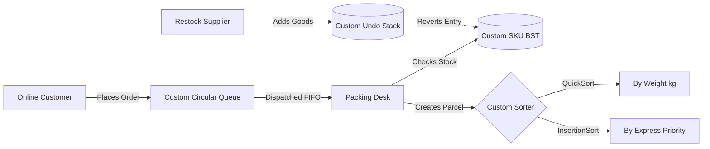
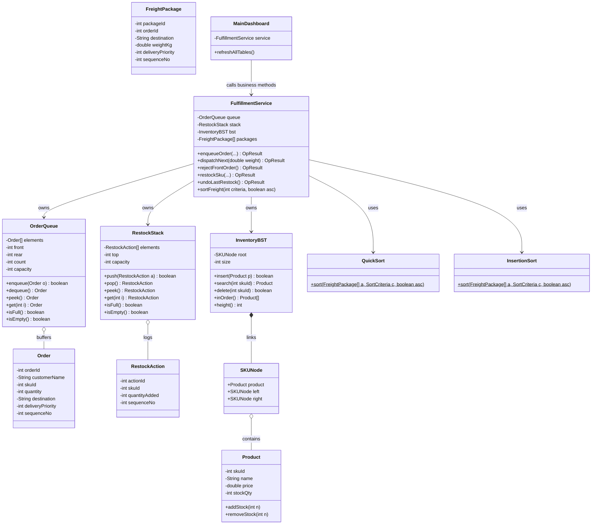
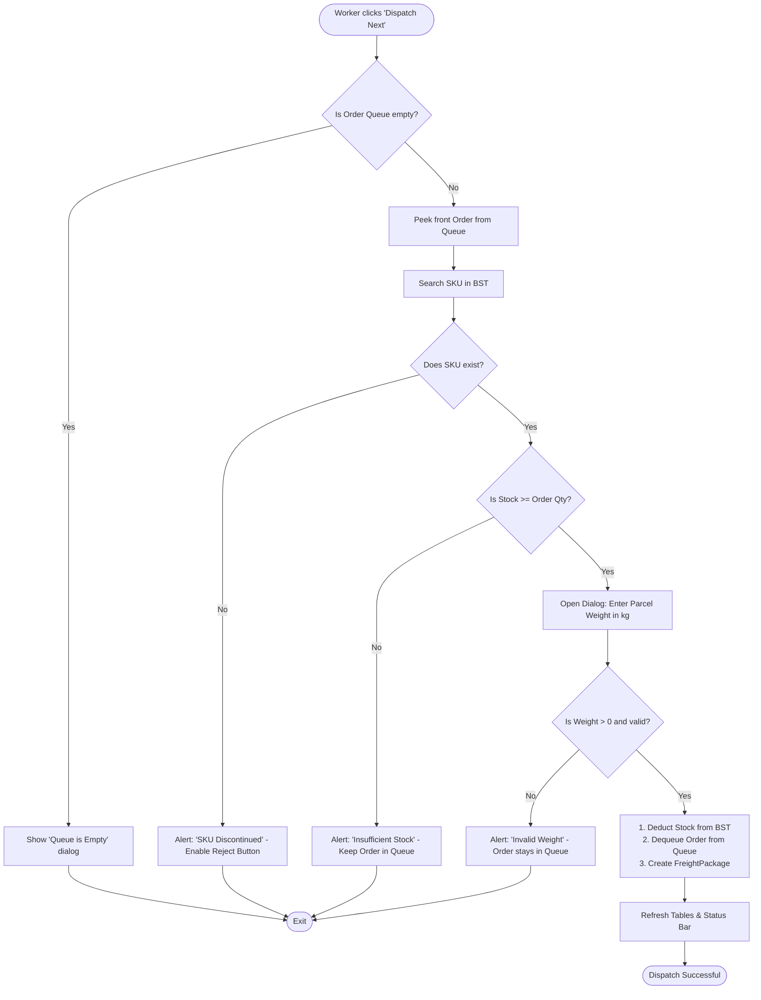
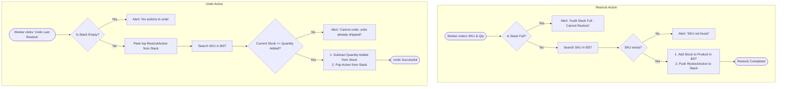
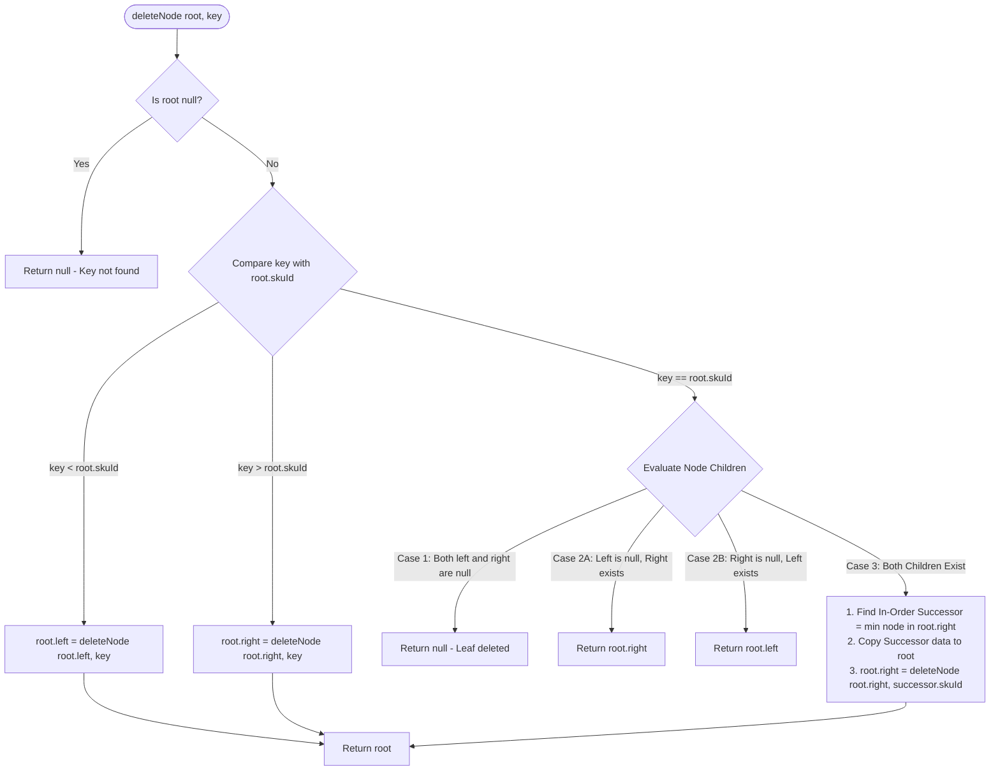
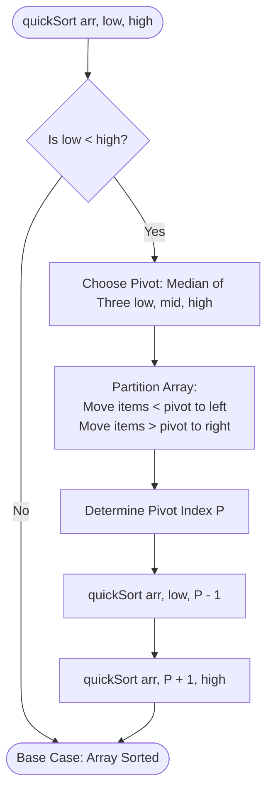

# 📦 E-Commerce Fulfillment & Logistics System
## Complete Plain-English Technical Documentation & System Guide
**Course:** BSIS 2nd Year — Data Structures & Algorithms (DSA)  
**Project:** 3-Week Final Laboratory Project — Group 1  
**Target Environment:** Java 17 LTS · Desktop Swing GUI · Standalone Executable JAR  

---

## 📑 Table of Contents
1. [Chapter 1: The Executive Tour (What Are We Building?)](#chapter-1-the-executive-tour-what-are-we-building)
2. [Chapter 2: The Data Structures in Plain English](#chapter-2-the-data-structures-in-plain-english)
   - [2.1 Circular Order Queue (FIFO)](#21-circular-order-queue-fifo)
   - [2.2 Restock Stack with Undo (LIFO)](#22-restock-stack-with-undo-lifo)
   - [2.3 Hierarchical SKU Index (Binary Search Tree)](#23-hierarchical-sku-index-binary-search-tree)
   - [2.4 Freight Sorting Engine (QuickSort & InsertionSort)](#24-freight-sorting-engine-quicksort--insertionsort)
   - [2.5 Time & Space Complexity Summary](#25-time--space-complexity-summary)
3. [Chapter 3: System Architecture & UML Class Diagrams](#chapter-3-system-architecture--uml-class-diagrams)
4. [Chapter 4: Algorithm Step-by-Step Flowcharts](#chapter-4-algorithm-step-by-step-flowcharts)
   - [4.1 Order Dispatch Flowchart (Peek → Validate → Commit)](#41-order-dispatch-flowchart-peek--validate--commit)
   - [4.2 Restock & Safe Undo Flowchart](#42-restock--safe-undo-flowchart)
   - [4.3 BST 3-Case Deletion Flowchart](#43-bst-3-case-deletion-flowchart)
   - [4.4 QuickSort Partitioning Flowchart](#44-quicksort-partitioning-flowchart)
5. [Chapter 5: Complete User Manual & Screen Guide](#chapter-5-complete-user-manual--screen-guide)
   - [5.1 Screen 1: Orders & Restock Hub](#51-screen-1-orders--restock-hub)
   - [5.2 Screen 2: SKU Catalog Index](#52-screen-2-sku-catalog-index)
   - [5.3 Screen 3: Freight Logistics Hub](#53-screen-3-freight-logistics-hub)
   - [5.4 Error Messages & Validation Guide](#54-error-messages--validation-guide)
6. [Chapter 6: 10-Minute Live Defense Presentation Guide](#chapter-6-10-minute-live-defense-presentation-guide)
   - [6.1 Minute-by-Minute Team Script](#61-minute-by-minute-team-script)
   - [6.2 Professor Q&A Defense Cheat Sheet](#62-professor-qa-defense-cheat-sheet)

---

# Chapter 1: The Executive Tour (What Are We Building?)

### 1.1 The Real-World Story
Imagine walking into a bustling e-commerce fulfillment warehouse like **Shopee, Lazada, or Amazon**. 
Every minute, hundreds of shoppers click "Buy Now" on their mobile phones. Delivery trucks are backing into the cargo bays, and warehouse staff are scanning barcodes, packing cardboard boxes, and restocking shelves.

Without specialized computer systems, chaos would quickly take over:
* Who bought the item first? 
* How do we locate product #4089 among 10,000 different shelves?
* What happens if a tired warehouse clerk accidentally restocks 500 laptops instead of 50?
* How do we pack the delivery vans so the heavy boxes sit safely at the bottom and express packages get dropped off first?

Our application is the **central desktop control software** that solves all four problems.



### 1.2 The Golden Rule of this Project
> **STRICT PROHIBITION:** To prove we understand core computer science, our professors strictly prohibited Java's built-in cheat codes (`ArrayList`, `LinkedList`, `Queue`, `Stack`, `HashMap`, and `Arrays.sort()`).  
> **Everything is hand-crafted from scratch** using primitive arrays (`[]`), explicit pointers (`Node left, right;`), and pure mathematical indexing.

### 1.3 The 3-Tier "Full Stack" Desktop Architecture
To prevent messy code where buttons directly touch data structures, we designed the software into 3 distinct layers:
1. **The View (Swing Desktop UI):** The buttons, input boxes, tables, and dialogs that warehouse workers interact with.
2. **The Brain (`FulfillmentService`):** The middleman that enforces business rules (making sure stock never goes below zero, validating order quantities, and ensuring undo actions are safe).
3. **The Engines (Custom Data Structures):** Pure Java classes (`OrderQueue`, `RestockStack`, `InventoryBST`, and custom sorters) with zero UI dependencies.

---

# Chapter 2: The Data Structures in Plain English

---

### 2.1 Circular Order Queue (FIFO)
* **What it represents:** The waiting line for customer orders.
* **The Rule:** **FIFO (First In, First Out)**. The first customer who places an order is the first customer whose order gets packed.
* **The Problem with a normal array queue:** If you put items in an array and remove them from the front, you leave empty slots at the beginning. To reuse them, you'd have to shift every single item left by one spot, which takes $O(n)$ time and slows down the computer.
* **The Plain-English Solution (A Circular Carousel):**
  Imagine a circular rotating carousel with 20 numbered trays (0 to 19).
  * `front` points to the tray holding the next order to pack.
  * `rear` points to the last order placed.
  * When an order arrives, we move `rear` forward: `rear = (rear + 1) % 20`. When we hit tray 19, the `% 20` math automatically wraps around back to tray 0!
  * **Result:** Adding an order (`enqueue`) and packing an order (`dequeue`) both run in instantaneous **$O(1)$ constant time**.

```text
[ Tray 0 ] <-- rear (Wrapped around)
[ Tray 1 ] <-- front (Next to dispatch)
[ Tray 2 ]
[ Tray 3 ]
...
[ Tray 19]
```

---

### 2.2 Restock Stack with Undo (LIFO)
* **What it represents:** The warehouse manager's transaction clipboard for restocking shelves.
* **The Rule:** **LIFO (Last In, First Out)**. Like a spring-loaded stack of cafeteria trays, the last item placed on top is the first item you pick up.
* **The Feature (Undo Last Restock):**
  When a shipment arrives, the operator adds +50 units of SKU 101. This action is pushed onto the top of the stack. If the operator realizes they typed 500 by mistake, clicking **"Undo"** pops the top card off the stack and reverses the mistake immediately.
* **The Real-World "Lost Update" Problem (Rule BR-06):**
  * *Naive way:* Restore the "previous stock" snapshot.
    * *Why this is dangerous:* Suppose stock was 10. We restock +50 (stock = 60). A customer buys 5 units (stock = 55). If you blindly restore the old snapshot "10", you just wiped out the customer's purchase and lost 45 units!
  * *Our Smart Solution:* **Undo subtracts the quantity added (`55 - 50 = 5`)**.
  * *Safety check:* If the warehouse already shipped those items and current stock is only 2, the system refuses the undo with: *"Cannot undo: units have already been shipped!"*

---

### 2.3 Hierarchical SKU Index (Binary Search Tree)
* **What it represents:** The digital warehouse map. Every product has a numeric barcode called a **SKU ID** (e.g., 101, 205, 309).
* **The Rule:** For any item in the tree:
  * All items with **smaller** SKU IDs go to the **Left**.
  * All items with **larger** SKU IDs go to the **Right**.

```text
         [SKU 50: Keyboard]
             /        \
   [SKU 30: Mouse]   [SKU 70: Monitor]
       /      \          /       \
   [20: Pad] [40: USB] [60: Cam] [80: Desk]
```

* **Why use a BST? (Lightning-Fast Lookup):**
  Instead of scanning 10,000 items one by one, looking for SKU 40 takes only 2 comparisons:
  1. Is 40 smaller than 50? Yes $\rightarrow$ Go Left to 30.
  2. Is 40 larger than 30? Yes $\rightarrow$ Go Right to 40. Found!  
  Search time is cut from $O(n)$ down to **$O(\log n)$ average time**.

* **In-Order Traversal (Sorted Table Display):**
  When we traverse the tree by visiting **Left Subtree $\rightarrow$ Current Node $\rightarrow$ Right Subtree**, the computer naturally reads the items in strictly ascending numerical order (`20, 30, 40, 50, 60, 70, 80`). This is how we populate our inventory table without needing any sorting algorithm!

* **The 3 Cases of Node Deletion (Worth 25% of the Grade):**
  When an item is discontinued, we remove it from the tree. There are 3 possibilities:
  * **Case 1 (Leaf Node — No Children):**  
    The node has no children below it (like SKU 20). Simply snip the connection from its parent.
  * **Case 2 (Single Child — One Branch):**  
    The node has one child below it. Bypass the deleted node and connect its parent directly to its child (like skipping a generation).
  * **Case 3 (Two Children — Two Branches):**  
    The node has two children (like deleting the root SKU 50). You cannot simply delete it, or the tree falls apart!  
    *The Solution:* Find the **In-Order Successor**—the smallest item in the right subtree (the "smallest bigger brother", SKU 60). Copy SKU 60's data into SKU 50's spot, then delete the old SKU 60 node from the right branch. The tree remains perfectly balanced!

---

### 2.4 Freight Sorting Engine (QuickSort & InsertionSort)
Once an order is packed into a cardboard box, it becomes a `FreightPackage` ready for shipping.

1. **QuickSort (Sorting by Weight in kg):**
   * *Analogy:* Dividing packages around a target weight.
   * *How it works:* Pick a package as the "pivot" (e.g., 5.0 kg). Move all packages lighter than 5.0 kg to the left, and all packages heavier to the right. Recursively repeat this on each side until the entire cargo manifest is sorted from lightest to heaviest.
   * *Performance:* Blazing fast **$O(n \log n)$** average time. Used to balance aircraft cargo holds.
2. **InsertionSort (Sorting by Delivery Priority):**
   * *Analogy:* Arranging playing cards in your hand.
   * *How it works:* Take each package one by one and insert it into its correct spot among the already-sorted packages.
   * *Why InsertionSort for priority?* It is **stable**. If package A and package B both have Priority 1 (Express), package A arrived first, so it stays ahead of package B! Runs in **$O(n)$** best time for nearly sorted data.

---

### 2.5 Time & Space Complexity Summary

| Component | Operation | Average Time | Worst Case Time | Space Complexity |
| :--- | :--- | :---: | :---: | :---: |
| **Circular Queue** | `enqueue()` / `dequeue()` | $O(1)$ | $O(1)$ | $O(N)$ fixed array |
| **Restock Stack** | `push()` / `pop()` | $O(1)$ | $O(1)$ | $O(N)$ fixed array |
| **Binary Search Tree**| `search()` / `insert()` | $O(\log n)$ | $O(n)$ *(if unbalanced)* | $O(n)$ dynamic nodes |
| **Binary Search Tree**| `delete()` (3 cases) | $O(\log n)$ | $O(n)$ | $O(1)$ pointer swaps |
| **Binary Search Tree**| `inOrderTraversal()` | $O(n)$ | $O(n)$ | $O(n)$ output array |
| **QuickSort** | Sort by Weight | $O(n \log n)$ | $O(n^2)$ *(bad pivot)* | $O(\log n)$ recursive stack |
| **InsertionSort** | Sort by Priority | $O(n^2)$ | $O(n^2)$ *(reversed)* | $O(1)$ in-place |

---

# Chapter 3: System Architecture & UML Class Diagrams

The system follows a strict **Model-View-Service** architectural pattern. No UI screen directly accesses arrays or pointers.



---

# Chapter 4: Algorithm Step-by-Step Flowcharts

---

### 4.1 Order Dispatch Flowchart (Peek → Validate → Commit)
Orders are never blindly dequeued. The system peeks at the front order and verifies inventory before committing the dispatch.



---

### 4.2 Restock & Safe Undo Flowchart
Restocking is atomic, and Undo protects against the "lost-update" regression.



---

### 4.3 BST 3-Case Deletion Flowchart
The complete decision tree handling leaf nodes, single children, and in-order successors.



---

### 4.4 QuickSort Partitioning Flowchart
How the divide-and-conquer algorithm partitions the freight package array by weight.



---

# Chapter 5: Complete User Manual & Screen Guide

The application window is designed to run at standard screen resolutions ($1366 \times 768$ and higher). It features three intuitive tabs and a bottom status bar.

---

### 5.1 Screen 1: Orders & Restock Hub

```text
+----------------------------------------------------------------------------------------------------+
| 📦 E-Commerce Fulfillment Hub - Group 1                                                            |
+----------------------------------------------------------------------------------------------------+
| [ Tab 1: Orders & Restock ]   [ Tab 2: SKU Catalog (BST) ]   [ Tab 3: Freight Logistics Sorter ]   |
+----------------------------------------------------------------------------------------------------+
| CUSTOMER ORDER QUEUE (FIFO)                     | INVENTORY RESTOCK & AUDIT (LIFO)                 |
| Customer: [ Alice Guo        ]                  | SKU ID:          [ 101       ]                   |
| SKU ID:   [ 101              ]                  | Quantity to Add: [ 50        ]                   |
| Quantity: [ 2                ]                  | [ + Restock SKU (Push) ]                         |
| Priority: [ 1 - Express      ]                  |                                                  |
| [ + Queue Order (Enqueue) ]                     | AUDIT LOG (Most Recent on Top)                   |
|                                                 | +------------+-------+--------+----------------+ |
| ACTIVE QUEUE (Order of Arrival)                 | | Action ID  | SKU   | Added  | Timestamp      | |
| +----------+---------------+-----+----+-------+ | +------------+-------+--------+----------------+ |
| | Order ID | Customer      | SKU | Qty| Prio  | | | #12        | 101   | +50    | 14:22:01       | |
| +----------+---------------+-----+----+-------+ | | #11        | 205   | +20    | 14:15:30       | |
| | #1001    | Juan Dela Cruz| 101 | 2  | 1     | | +------------+-------+--------+----------------+ |
| | #1002    | Maria Santos  | 104 | 1  | 3     | | [ ⏪ Undo Last Restock (LIFO Pop) ]             |
| +----------+---------------+-----+----+-------+ |                                                  |
| [ 🚀 Dispatch Next Order ] [ ❌ Reject Front ]  |                                                  |
+----------------------------------------------------------------------------------------------------+
| Status: Queue 2/20 | Restock Log: 2 | Catalog: 14 SKUs (Height: 4) | Packages: 5                   |
+----------------------------------------------------------------------------------------------------+
```

#### Step-by-Step Operator Actions:
1. **Queueing a Customer Order:**
   * Enter the customer's name, the desired SKU ID, the quantity, and choose the delivery priority (1 to 5).
   * Click **"Queue Order (Enqueue)"**. The order is added to the circular queue and immediately appears at the bottom of the active queue table.
2. **Dispatching the Next Order:**
   * Click **"Dispatch Next Order"**.
   * The system looks up the front order in the BST. If stock is available, a small dialog pops up: *"Enter parcel weight (kg):"*.
   * Type the weight (e.g., `2.45`) and click OK. The stock is deducted from the BST, the order leaves the queue, and a new freight package is generated.
3. **Handling Out-of-Stock Orders:**
   * If the customer ordered 10 units but only 3 exist, an error popup informs the operator: *"Insufficient stock (Available: 3, Requested: 10)"*. The order remains safely in the queue.
   * The operator can either restock the item or click **"Reject Front"** to remove the unfulfillable order and log it as rejected.
4. **Restocking Goods & Reversing Mistakes:**
   * Type the SKU ID and quantity received, then click **"Restock SKU (Push)"**. The stock is added to the BST, and the action is logged at the top of the audit table.
   * If you made a typo, click **"⏪ Undo Last Restock"**. The system checks that the restocked units haven't already been dispatched, rolls back the stock, and removes the log entry.

---

### 5.2 Screen 2: SKU Catalog Index

```text
+----------------------------------------------------------------------------------------------------+
| REGISTER NEW PRODUCT                           | LOOKUP & SEARCH PRODUCT                           |
| SKU ID:       [ 305       ]                    | Enter SKU ID: [ 305       ]  [ 🔍 Search SKU ]    |
| Product Name: [ Mechanical Keyboard ]          | Result: Mechanical Keyboard | $49.99 | Stock: 15  |
| Unit Price:   [ 49.99     ]                    |                                                   |
| Initial Stock:[ 20        ]                    | [ 🗑️ Discontinue / Delete SKU ]                   |
| [ + Add Product to Tree ]                      |                                                   |
+----------------------------------------------------------------------------------------------------+
| MASTER INVENTORY DIRECTORY (Populated via BST In-Order Traversal)                                  |
| +--------+------------------------------------+---------------+------------+--------------------+ |
| | SKU ID | Product Name                       | Price ($)     | Stock Qty  | Status             | |
| +--------+------------------------------------+---------------+------------+--------------------+ |
| | 101    | Wireless Mouse                     | $18.50        | 45         | In Stock           | |
| | 104    | USB-C Hub Adapter                  | $24.00        | 12         | Low Stock          | |
| | 205    | Ergonomic Desk Mat                 | $15.00        | 80         | In Stock           | |
| | 305    | Mechanical Keyboard                | $49.99        | 15         | In Stock           | |
| +--------+------------------------------------+---------------+------------+--------------------+ |
```

#### Step-by-Step Operator Actions:
1. **Adding a Product:**
   * Enter a unique numeric SKU ID, name, price, and stock count.
   * Click **"Add Product to Tree"**. The item is inserted recursively into the BST. The inventory table refreshes in ascending SKU order.
2. **Searching for a Product:**
   * Enter the SKU ID in the search box and click **"Search SKU"**.
   * The system navigates the tree in $O(\log n)$ steps and populates the details on screen.
3. **Deleting a Discontinued Product:**
   * Search for the SKU ID, then click **"Discontinue / Delete SKU"**.
   * A confirmation dialog appears: *"Are you sure you want to delete SKU #305?"*.
   * Upon confirmation, the 3-case node deletion algorithm safely removes the node without corrupting the tree structure.

---

### 5.3 Screen 3: Freight Logistics Hub

```text
+----------------------------------------------------------------------------------------------------+
| FREIGHT CARGO MANIFEST (Packages Ready for Van Loading)                                            |
| Active Sort: [ Sorted by Weight (kg) · Algorithm: QuickSort · Order: Ascending ]                   |
|                                                                                                    |
| [ ⚖️ Sort by Weight (QuickSort) ]  [ ⚡ Sort by Priority (InsertionSort) ]  [ 🔄 Toggle Asc/Desc ]  |
+----------------------------------------------------------------------------------------------------+
| +------------+----------+----------------------+-------------+--------------------+--------------+ |
| | Package ID | Order ID | Destination          | Weight (kg) | Delivery Priority  | Dispatch Seq | |
| +------------+----------+----------------------+-------------+--------------------+--------------+ |
| | PKG-501    | #1004    | Quezon City Hub      | 0.45 kg     | 1 - Express        | Seq #1       | |
| | PKG-502    | #1001    | Manila Central Hub   | 1.20 kg     | 1 - Express        | Seq #2       | |
| | PKG-503    | #1003    | Makati Logistics Hub | 3.50 kg     | 2 - Priority       | Seq #3       | |
| | PKG-504    | #1002    | Pasig Cargo Depot    | 12.80 kg    | 3 - Standard       | Seq #4       | |
| +------------+----------+----------------------+-------------+--------------------+--------------+ |
```

#### Step-by-Step Operator Actions:
1. **Sorting by Weight (QuickSort):**
   * Click **"Sort by Weight (QuickSort)"**. The table re-renders instantly with the lightest packages at the top.
2. **Sorting by Urgency (InsertionSort):**
   * Click **"Sort by Priority (InsertionSort)"**. The packages are rearranged with Priority 1 (Express) at the top. Packages with identical priority maintain their initial arrival order (stable sort).
3. **Header-Click Sorting:**
   * Clicking the "Weight" or "Delivery Priority" table header triggers the exact same custom sorting algorithms.

---

### 5.4 Error Messages & Validation Guide

| Error Condition | Triggering Event | Popup Title | Friendly Message Displayed |
| :--- | :--- | :--- | :--- |
| **Blank Inputs** | Leaving fields empty when adding an order or SKU | Validation Error | *"Please fill in all required fields."* |
| **Non-Numeric ID** | Typing `"abc"` or `"$10"` into the SKU box | Input Error | *"SKU ID must be a valid positive whole number."* |
| **Negative Stock** | Entering `-5` for restock or price | Range Error | *"Values cannot be negative or zero."* |
| **Duplicate SKU** | Inserting a SKU ID that already exists in the BST | Conflict Error | *"SKU ID already exists in the catalog. Duplicates are rejected."* |
| **Queue Overflow** | Adding an order when the queue has reached capacity | Buffer Full | *"Order queue is at maximum capacity (20/20). Please dispatch orders first."* |
| **Queue Underflow**| Clicking "Dispatch Next" when the queue is empty | Queue Empty | *"The order queue is empty. No orders waiting to be dispatched."* |
| **Stack Overflow** | Restocking when the undo log has reached capacity | Storage Full | *"Restock audit stack is full. Cannot record further restocks."* |
| **Stack Underflow** | Clicking "Undo" when no restocks exist in the session | Undo Notice | *"No restock actions available to undo."* |
| **Undo Rejected** | Trying to undo a restock after the units were already shipped | Operation Blocked | *"Cannot undo restock: some units have already been dispatched!"* |

---

# Chapter 6: 10-Minute Live Defense Presentation Guide

---

### 6.1 Minute-by-Minute Team Script

| Time | Presenter | What to Say & What to Click on Screen |
| :---: | :--- | :--- |
| **0:00 - 1:00** | **Member 1** *(Lead)* | **Introduction & Launch:**<br>• Greet the panelists: *"Good morning, professors. We are Group 1 presenting our E-Commerce Fulfillment & Logistics System."*<br>• Show that the `.jar` launches by double-clicking it on the desktop with no IDE open.<br>• Introduce the 3-tier architecture and point out the zero-collections compliance. |
| **1:00 - 3:00** | **Member 3** *(BST Dev)* | **Module 2 (BST) Demonstration:**<br>• Open Tab 2. Point out that the catalog is populated via **In-Order Traversal**.<br>• Demonstrate **Search** by typing a SKU: details autofill instantly in $O(\log n)$ time.<br>• Demonstrate **3-Case Deletion**: delete a leaf node (Case 1), then delete a node with two children (Case 3), explaining how the In-Order Successor takes its place. |
| **3:00 - 5:00** | **Member 2** *(Linear ADT)* | **Module 1 (Queue & Stack) Demonstration:**<br>• Open Tab 1. Enqueue 2 new orders to demonstrate FIFO buffering.<br>• Click **"Dispatch Next"**, enter parcel weight, and show the order moving from Queue $\rightarrow$ Freight.<br>• Trigger an **Insufficient Stock** warning to show the validate-before-commit logic.<br>• Restock an item, then click **"Undo Last Restock"** to demonstrate LIFO rollback. |
| **5:00 - 6:30** | **Member 4** *(Sorting Dev)* | **Module 3 (Sorting Engine) Demonstration:**<br>• Open Tab 3. Show the unsorted packages.<br>• Click **"Sort by Weight"** (QuickSort) and explain the divide-and-conquer pivot partition.<br>• Click **"Sort by Priority"** (InsertionSort) and explain why stability keeps earlier orders first.<br>• Click a column header to demonstrate dynamic re-sorting without `TableRowSorter`. |
| **6:30 - 8:00** | **Member 5** *(QA Lead)* | **Architecture, Flowcharts & Code Quality:**<br>• Present the UML Class Diagram and the Dispatch Flowchart.<br>• Run the PowerShell compliance regex script on screen to prove **zero forbidden imports**.<br>• Show that the status bar tracked all tree heights and queue sizes accurately. |
| **8:00 - 10:00** | **Entire Team** | **Q&A Panel Defense:** Answer the professors' questions confidently. |

---

### 6.2 Professor Q&A Defense Cheat Sheet

#### Q1: "Why did you use a circular array instead of a simple array for the Queue?"
> **Answer:** *"If we used a standard array, removing an item from the front would leave an empty spot. Shifting all remaining items left takes $O(n)$ time. By using circular modulo arithmetic `(index + 1) % capacity`, the front and rear pointers wrap around in a circle, allowing both `enqueue` and `dequeue` to execute in lightning-fast $O(1)$ constant time with zero memory waste."*

#### Q2: "What is the worst-case time complexity of your Binary Search Tree, and how did you prevent it during your demo?"
> **Answer:** *"The average search time is $O(\log n)$. However, if SKUs are inserted in strictly sorted order (1, 2, 3, 4), the tree degenerates into a single straight line—a linked list—with worst-case $O(n)$ search time. To prevent this during our demonstration, our system preloads seed data in a balanced, mixed order (e.g., 50, 30, 70, 20, 40, 60, 80), keeping the tree height at a compact 3."*

#### Q3: "In BST deletion, why do you replace a node with two children with its In-Order Successor?"
> **Answer:** *"The In-Order Successor is the smallest node in the right subtree. Because it is greater than everything in the left subtree, but smaller than everything else in the right subtree, moving it into the deleted node's position preserves the strict Binary Search Tree invariant without requiring any other nodes to be moved."*

#### Q4: "What if the In-Order Successor itself has a child?"
> **Answer:** *"By mathematical definition, the In-Order Successor is the leftmost node in the right subtree, meaning it can never have a left child. It can only ever have a right child or no children. Therefore, removing the successor is always trivial: it is simply Case 1 (leaf) or Case 2 (one child)."*

#### Q5: "Why did you choose QuickSort for weight, but InsertionSort for delivery priority?"
> **Answer:** *"QuickSort is an $O(n \log n)$ divide-and-conquer algorithm ideal for large datasets with continuous floating-point numbers like weights. However, QuickSort is not stable. For delivery priority, we chose InsertionSort because it is **stable**—meaning packages with the same priority (e.g., two Express parcels) remain in the exact order they arrived."*

#### Q6: "Why does your Undo feature subtract the quantity instead of restoring the previous stock snapshot?"
> **Answer:** *"If stock is 10, we restock +50 (total 60), and an order dispatches 5 units (leaving 55), restoring the snapshot of '10' would erase the 5-unit sale and lose 45 units of inventory! By subtracting the `quantityAdded` ($55 - 50 = 5$), we protect the integrity of sales made between the restock and the undo. Furthermore, if stock had dropped below 50, our system refuses the undo because those units were already shipped."*

#### Q7: "How did you prove that you didn't use any Java Collections?"
> **Answer:** *"We designed our own `SortCriteria<T>` interface rather than using `java.util.Comparator`, and implemented our own generic `ArrayQueue` and `ArrayStack`. We verified compliance using automated regex scans across all `.java` source files to confirm zero prohibited `java.util.*` imports."*
