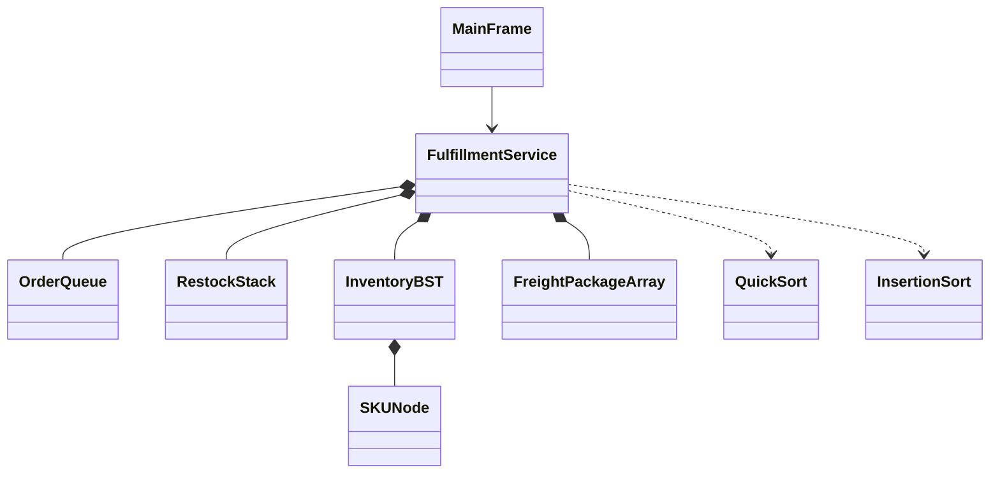
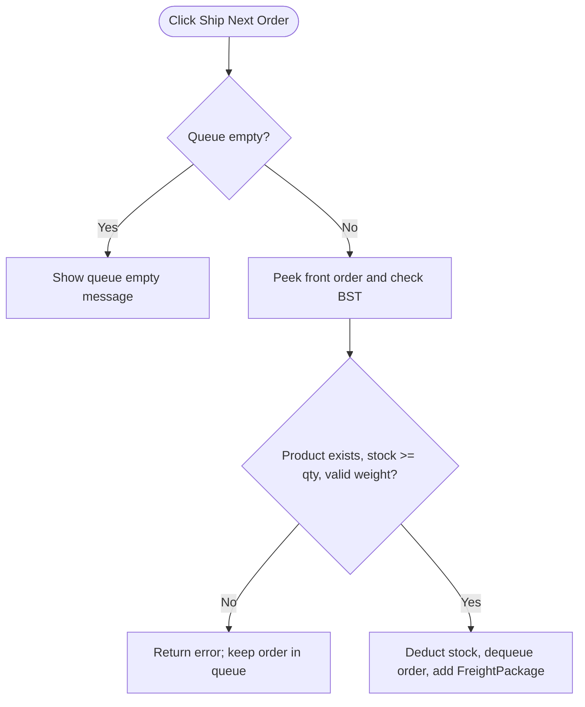
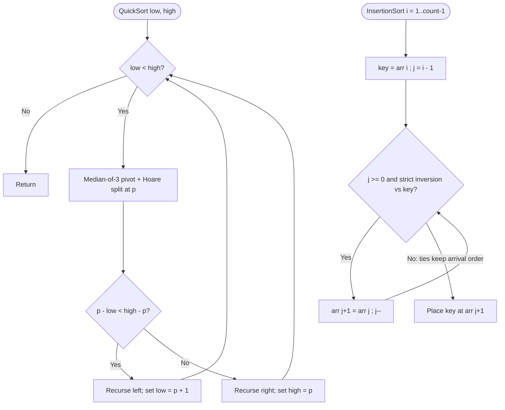

# Order & Shipping Manager (Logistics Hub)
**Group 1 · BSIS 2nd Year · Data Structures and Algorithms · Final Laboratory Project**  
*Technical Documentation and User Guide*

**Domain:** E-Commerce Fulfillment and Logistics. Built with **Java 17** and **Swing**. No outside libraries and no `java.util` collections.

This document explains what our app does, how it is built, how to use it, and how we will defend it. The first half is for anyone who wants to understand the system. The second half is the user guide, our test notes, and our defense plan.

---

## 1. What the app does

Logistics Hub is a desktop program for the back room of an online store—the place where orders get packed and sent out, like the warehouse of a Shopee or Lazada seller. It works offline. You double-click one JAR file and it opens. Nothing is saved to a database, so it starts from the same sample data every time.

A warehouse worker has four daily jobs, and the app has one screen for each:

1. **Products.** The list of everything the store sells, with a product code, a name, a price in pesos (`₱`), and the stock left. You can search for an item by code or name, add a new one, or delete one that is no longer sold.
2. **Orders.** Customer orders wait in line, first come first served. The worker checks the stock, ships the order at the front, or cancels it, and the stock count stays correct either way.
3. **Restock.** When a supplier delivers more items, the worker records it here. If someone typed the wrong number, **Undo Last Restock** fixes it, unless some of those items have already been shipped.
4. **Shipments.** The packages that have been sent out. They can be sorted by weight or by delivery speed, or by clicking the column headers.

There is a reason for splitting it this way. Each screen shows one of the data structures our subject asks for: **Orders** is the queue, **Restock** is the stack, **Products** is the binary search tree, and **Shipments** is the array with the sorting algorithms.

### The rules we followed
- **Java 17 only.** We compile with `javac --release 17` into one runnable file, `LogisticsHub.jar` (49 class files).
- **No outside libraries and no Java collections.** Under [`FINAL-Project-Guide (1).pdf`](guidelines/FINAL-Project-Guide%20(1).pdf), none of these appear anywhere in our `src` folder: `ArrayList`, `LinkedList`, `Queue`, `Stack`, `HashMap`, `Arrays.sort`, `Comparator`, `java.time`, `java.text`, or any look-and-feel JAR. We wrote our own versions of what we needed.
- **Every table uses `AbstractTableModel`** and its cells cannot be edited (`isCellEditable` returns `false`). We did not use `DefaultTableModel` or `TableRowSorter`. Clicking a column header to sort is handled by our own mouse listeners.

---

## 2. How the program is organized

We split the code into layers so that button clicks do not contain business rules or pointer logic. The screens only show things and pass requests along. A service class decides what is allowed. The data structures only store and retrieve data. In total there are **30 source files**, plus **6 test programs**.

| Part | Package | What it does |
| :--- | :--- | :--- |
| **Entry point** | `com.group1.logistics` | `Main` sets the system look and feel and opens `MainFrame` safely on the Swing event thread. |
| **Screens** | `com.group1.logistics.ui` | `MainFrame`, `SidebarPanel`, `UiTheme`, four panels (one per screen), four table models and three pop-up dialogs. A navy sidebar on the left, the active screen in the middle, a message strip at the bottom, and icons and colored status labels drawn with Java 2D. The screens only talk to `FulfillmentService`. |
| **Service (the brain)** | `com.group1.logistics.service` | `FulfillmentService` and `OpResult`. It enforces business rules `BR-01` to `BR-09`, checks stock before an order leaves the queue, counts queued quantities as already taken, and blocks an undo that would erase shipped items. `OpResult` carries success or failure, plus a message, back to the screen. |
| **Data structures** | `com.group1.logistics.datastructures` | `OrderQueue`, `RestockStack`, `InventoryBST`, `SKUNode` and `FreightPackageArray`, all built by hand: a circular array queue, a stack with a top pointer, a binary search tree with left and right pointers, and an array that doubles when full. |
| **Sorting** | `com.group1.logistics.sorting` | `SortCriteria`, `PackageCriteria`, `QuickSort` and `InsertionSort`. Our own comparison interface, a Hoare QuickSort for weight and package number, and a stable InsertionSort for delivery speed and destination. |
| **Models** | `com.group1.logistics.models` | `Product`, `Order`, `RestockAction` and `FreightPackage`. They refuse bad values: no negative stock, no zero or negative IDs, no infinite weights, and priority must be 1 to 5. |

### What the app starts with
All of this is loaded by `FulfillmentService.loadDefaultSeedData()` when the app opens:
- **14 products.** We insert them in a chosen order (`500, 300, 700, 200` and so on) so the tree comes out balanced with a height of **4**, instead of a long chain.
- **0 orders.** The first order you place becomes **`#1001`**, and the stock numbers on screen match the full shelf.
- **2 restock records** (product `300` with `+20`, product `500` with `+15`) and **5 shipments** (`PKG-501` to `PKG-505`, for orders `#991` to `#995`).

---

## 3. The data structures and sorting, explained simply

### 3.1 The order queue (circular array)
Picture a packing counter with 20 trays on a turntable. Orders go into the next empty tray. When we ship the first order, we do not slide every other order forward, because that would mean moving everything each time. We just move the front marker one tray along. When a marker passes tray 19 it goes back to tray 0. That wrap-around is done with the remainder operator: `(index + 1) % 20`.

- **`enqueue`:** move `rear` to `(rear + 1) % 20`, store the order there, and add 1 to `count`. It takes the same short time no matter how many orders are waiting, which is **O(1)**.
- **`dequeue`:** return the order at `front`, set that slot to `null`, and move `front` to `(front + 1) % 20`. Also **O(1)**.
- **`get(logicalIndex)`:** read `elements[(front + logicalIndex) % 20]`. This is why row 0 on the **Orders** screen is always the next order to ship, even after the queue has wrapped around.

### 3.2 The restock stack (undo history)
Think of a pile of slips on a clipboard. Each new restock goes on top, and the only one you can take off is the top one. Push and pop both work at the top, so both are **O(1)**. To show the list on screen we read `elements[top - indexFromTop]`, so row 0 is always the latest restock.

Undo (rule `BR-06`) does not put back an old stock number. It subtracts the quantity that was added. Here is why that matters. Say a product has 10 in stock, we restock 20 (now 30), and then 5 are shipped (now 25). Undoing the restock should leave 5, which is 25 minus 20. If we had saved the old number (10) and put it back, we would be bringing back 5 items that already left the warehouse. And if the stock is lower than the amount we are trying to undo, the undo is blocked, because it means those items were already shipped.

### 3.3 The product tree (binary search tree)
Each node holds one product and is sorted by product code (`skuId` in the code). Smaller codes go to the left and larger codes go to the right.

- **No duplicates (`BR-01`).** Our rule is `left < root < right`. The course prompt writes `left <= root < right`, but a product code identifies one item in the catalog, so a duplicate would split one product's stock across two nodes. Inserting an existing code just returns `false` and nothing changes.
- **Insert and search.** Insert goes down the tree with recursion and returns the updated child pointers. Search is a loop instead of recursion, so it uses no extra stack space. Both take about **O(log n)** when the tree is balanced.
- **In-order traversal** (`left`, then `root`, then `right`) gives the products already sorted by code, so the **Products** table never needs a separate sort.
- **Delete** handles three cases: a leaf, a node with one child, and a node with two children (see Section 5).
- **For speed on screen,** the product table model keeps prices, lowercase names, available stock and the counts in memory and refreshes them once per refresh. A numeric search uses the tree and a binary search on the rows (`findRowBySkuId`). When you type in the search box, the app waits **250 ms** (a Swing `Timer`) after the last key before searching.

### 3.4 The package array and the two sorts
`FreightPackageArray` is a plain `FreightPackage[]` that starts with room for 16 packages. When it is full, we make an array twice as big and copy everything over with `System.arraycopy`. This is our replacement for `ArrayList`.

- **QuickSort** sorts by weight and by package number.
  - It uses Hoare partitioning with a median-of-three pivot, which avoids the slow worst case when the list is already sorted.
  - After each split it recurses on the smaller half and loops on the larger half. This keeps the call stack short, so even 50,000 packages with the same weight do not cause a `StackOverflowError`.
  - If two weights are equal, the package with the lower sequence number goes first.
- **InsertionSort** sorts by delivery speed and by destination.
  - It only moves an item when the comparison is strictly greater than (or strictly less than) the one before it. Items that are equal never swap.
  - That makes it **stable**: packages with the same delivery speed stay in the order they arrived.

Why two different sorts? Weights are decimals with many different values, so we want a fast divide-and-conquer sort. Delivery speed has only a few levels with lots of ties, so keeping ties in arrival order matters more than raw speed.

| Structure or sort | Main operations | Average time | Worst case | Extra space |
| :--- | :--- | :--- | :--- | :--- |
| `OrderQueue` | `enqueue`, `dequeue`, `peek`, `get` | `O(1)` | `O(1)` | `O(N)`, fixed array of 20 |
| `RestockStack` | `push`, `pop`, `peek`, `get` | `O(1)` | `O(1)` | `O(N)`, fixed array of 20 |
| `InventoryBST` | `insert`, `search`, `delete` | `O(log n)` | `O(n)` if unbalanced | `O(log n)` for recursion, `O(1)` for search |
| `InventoryBST` | `inOrder()` | `O(n)` | `O(n)` | `O(n)` for the sorted output |
| `FreightPackageArray` | `add`, `get` | `O(1)` amortized | `O(n)` when it resizes | `O(n)` from doubling |
| `QuickSort` | sort by weight or package no. | `O(n log n)` | `O(n²)` | `O(log n)` |
| `InsertionSort` | sort by delivery speed or destination | `O(n²)`, close to `O(n)` if almost sorted | `O(n²)` | `O(1)`, sorts in place |

---

## 4. Business rules

These are the rules the service layer enforces. Each one has an ID so we can point to it in the code and in the tests.

| Rule | What it means | Where it is enforced |
| :--- | :--- | :--- |
| `BR-01` | A product code must be positive and unique. A duplicate is rejected. | `FulfillmentService.addProduct()`, `InventoryBST` |
| `BR-02` | An order needs a product that exists, a quantity of at least 1 within available unreserved stock, a valid customer name and destination (the pipe symbol `|` is not allowed), and a priority from 1 to 5. | `FulfillmentService.enqueueOrder()`, `Order` |
| `BR-03` | Shipping checks first and changes things later (peek, validate, commit). The order only leaves the queue if the product exists, the stock covers the quantity and the weight is valid. Otherwise it stays in line, unless the user cancels it. | `FulfillmentService.dispatchNext()` |
| `BR-04` | Real stock can never go below zero. | `Product.addStock()`, `Product.removeStock()` |
| `BR-05` | A restock is all or nothing. The product must exist and the stack must not be full before anything is changed. | `FulfillmentService.restock()` |
| `BR-06` | Undo subtracts the quantity that was added, but only if the current stock is at least that much. If not, the items were already shipped and the undo is blocked. | `FulfillmentService.undoRestock()` |
| `BR-07` | Deleting a product needs confirmation and uses the three-case tree delete. Orders in the queue that point to a deleted product are flagged. | `CatalogPanel`, `FulfillmentService.deleteProduct()` |
| `BR-08` | A shipment needs a valid dispatch. The service accepts weights from `0.01` to `1000.00 kg`, while the pop-up on screen only allows `0.01` to `50.00 kg`. | `FulfillmentService.dispatchNext()`, `FreightPackage` |
| `BR-09` | Sorting only changes the package array. It never touches the tree, the queue or the stack. | `FulfillmentService.sortPackages()` |

### How stock is reserved while an order is waiting
The stock shown on screen is the **available stock**, not the number sitting on the shelf:

`available = max(0, shelf stock minus the total quantity of waiting orders for that product)`

This stops two customers from ordering the same last items. Here is an example with **Motorized Standing Desks**, which start at 8:
1. **Place an order for all 8.** The Products screen drops from 8 to 0 and shows **Out of Stock**. Nobody else can order those 8.
2. **Ship that order.** Shelf stock goes from 8 to 0 and the reservation goes from 8 to 0, so the screen still shows 0. Nothing is deducted twice.
3. **Or cancel the order instead.** Shelf stock stays at 8, the reservation is cleared, and the screen goes back to 8 (shown as **Low Stock**, because 20 or under counts as low).

---

## 5. Diagrams and flowcharts

### 5.1 How the classes fit together
`MainFrame` holds the service, the sidebar and a card layout that switches between the four screens. It calls `FulfillmentService`, which owns the order queue, the restock stack, the product tree and the package array. Every service method returns an `OpResult` (success or failure, plus a message). The data structure classes and the sorts sit below the service, and the four model classes (`Product`, `Order`, `RestockAction` and `FreightPackage`) are what they store.



### 5.2 Three flows worth knowing

- **Shipping an order (peek, validate, commit):**
  1. The worker clicks **Ship Next Order**. If the queue is empty, we stop.
  2. We look at the front order without removing it and find its product in the tree.
  3. If the stock covers the quantity and the weight is valid, we take the stock off the shelf, remove the order from the queue, add a package to the shipments array and refresh the screens.
  4. If not, we return an error message and the order stays where it was.

- **Safe undo (`BR-06`):**
  1. The worker clicks **Undo Last Restock**. If the stack is empty, we stop.
  2. We look at the top entry and find its product.
  3. If the current stock is at least the quantity that was added, we subtract it and pop the stack.
  4. If not, the undo is blocked and the entry stays, because those units already shipped.

- **Deleting from the tree:**  
  We go left if the code is smaller and right if it is bigger until we find the node. Then:
  - **Case 1, a leaf:** just remove it.
  - **Case 2, one child:** connect the parent straight to that child.
  - **Case 3, two children:** find the smallest node in the right subtree (the in-order successor), copy it into this node, then delete the successor from the right subtree.  
  The size counter goes down only once, after the recursion finishes. When the successor is deleted, a separate dummy flag is passed along so that it does not count as a second removal.



### 5.3 The two sorting flows
- **QuickSort:** While `low` is less than `high`, pick a median-of-three pivot, split the range with Hoare partitioning, and break ties by sequence number. Then recurse on the smaller side and keep looping on the larger side.
- **InsertionSort:** For each item from position 1 onward, hold it as the key and compare it with the items to its left. Shift a left item to the right only if it is strictly out of order. Then put the key in the gap. Equal items never move past each other, which is what keeps arrival order on ties.



*(See [`LogisticsHub-Documentation.pdf`](LogisticsHub-Documentation.pdf) for the rendered visual diagrams and screen captures.)*

---

## 6. User guide

Double-click `LogisticsHub.jar` (or run `run.bat`). You can move between screens with the sidebar on the left or with `Ctrl+1` (Orders), `Ctrl+2` (Products), `Ctrl+3` (Restock) and `Ctrl+4` (Shipments).

The **Technical details** checkbox at the bottom of the sidebar shows what is happening inside, like the BST height, the sequence numbers (`Seq #`) and the name of the sorting algorithm. Leave it off for normal use and turn it on during the defense.

### 6.1 Products (`Ctrl+2`)
- Filter pills at the top show counts for **All**, **In Stock** (more than 20) and **Low / Out** (20 or less).
- The stock column shows available stock, which is shelf stock minus whatever is in waiting orders. The status labels are **In Stock** (more than 20), **Low Stock** (1 to 20) and **Out of Stock** (0).
- **Search:** Type a product code or part of a name. A code uses the tree, and a name is matched as you type. Press `Enter` to highlight a result, press `Esc` to clear, or click **Refresh** to update the counts.
- **Add Product:** Click **+ Add Product** and enter a unique code, a name, a price in pesos and the starting stock.
- **Delete:** Select a row and click **Delete**. The app asks you to confirm first.

### 6.2 Orders (`Ctrl+1`)
- The queue starts empty (`0/20`), so the first order you place is **`#1001`** and it is marked **NEXT**.
- **Place Order:** Click **+ Place Order**, then type the customer name, choose a product (the pop-up shows how many are available), set the quantity, pick a Delivery Speed (**Express** is fastest, **Standard** is the default, **Economy** is slowest) and choose where it goes: **Manila Central Hub**, **Quezon City Hub** or **Makati Logistics Hub**.
- **Ship Next Order:** Checks that there is enough stock, asks for the parcel weight (`0.01` to `50.00 kg`), takes the items off the shelf and sends a package to **Shipments**.
- **Cancel Next:** Removes the order at the front and frees up the stock that was held for it.
- Under the table, a counter shows how many orders are waiting out of 20.

### 6.3 Restock (`Ctrl+3`)
- **Add Stock:** Pick a product, enter how many arrived (`10` by default) and submit. The shelf stock goes up and the new entry appears at the top of the list.
- **Undo Last Restock:** Asks you to confirm, then takes the top entry back out by subtracting what it added. If those units were already shipped, the app blocks the undo and tells you why.

### 6.4 Shipments (`Ctrl+4`)
- **Sort by Weight** uses `QuickSort`. The direction button switches between **Lightest First** and **Heaviest First**.
- **Sort by Delivery Speed** uses `InsertionSort`. The direction button switches between **Fastest First** and **Slowest First**. Packages with the same speed stay in the order they were shipped.
- You can also click a column header (**Package No.**, **Deliver To**, **Weight** or **Delivery Speed**) to sort by it.

### 6.5 When something goes wrong

| What the user did | What the app does |
| :--- | :--- |
| Entered a duplicate product code, an empty name, a customer name made only of numbers, or a quantity of zero or less | Rejects it with a message. For a duplicate code the message reads: `SKU ID #... already exists (BR-01)`. |
| Ordered more than the available stock, or tried to ship an order bigger than the stock | Blocks it. The orders already waiting stay safely in line. |
| Tried to add to a queue or stack that is already full (20 of 20) | Tells the operator it is full. Older orders and restock entries are never overwritten. |
| Tried to undo a restock after those units were shipped | Blocks the undo and shows the current stock against what is needed. The message reads: `Cannot undo: units have already been shipped/dispatched!`. |

---

## 7. Testing and our defense

### 7.1 Tests
We wrote six standalone Java test programs. All of them compile with `javac --release 17` and pass.

| Test program | What it checks |
| :--- | :--- |
| `LinearADTTest` | Queue wrap-around and capacity limits, first-in-first-out order, stack last-in-first-out order, and overflow and underflow guards. |
| `BSTTest` | Recursive insert, search, sorted in-order traversal, all three delete cases, and the size not being reduced twice. |
| `SortTest` | QuickSort ascending and descending, 20,000 equal weights without a stack overflow, and InsertionSort keeping ties in order. |
| `ServiceTest` | Rules `BR-01` to `BR-09`, shipping that happens fully or not at all, not enough stock, safe undo (`BR-06`), and the tree staying untouched by sorting (`BR-09`). |
| `FullSystemCheckupTest` | The empty starting queue, orders `#1001` and `#1002` through their full life, the Standing Desk reservation (`8` to `0` to `8` to `0`), and tables that cannot be edited and cache their data. |
| `UltimatePerformanceTest` | Speed checks: 2 million queue operations, 2 million stack operations, 10,000 tree inserts with 100,000 lookups, QuickSort on 50,000 equal weights, and InsertionSort on 5,000 items. |

```powershell
javac --release 17 -encoding UTF-8 -d bin (Get-ChildItem -Recurse -Filter *.java src).FullName
Select-String -Path (Get-ChildItem -Recurse -Filter *.java src).FullName `
  -Pattern 'import\s+java\.(util|time|text)\.|DefaultTableModel|TableRowSorter|FlatLaf|MigLayout'
# Result: 0 matches found — Zero Java Collections & Zero External Libraries verified.
```

### 7.2 Our 10-minute defense plan

| Time | Who | What we show and say |
| :--- | :--- | :--- |
| **0:00 to 1:30** | UI/UX and Integration Lead | Open `LogisticsHub.jar` outside the IDE. Introduce the four screens, Java 17, no outside libraries, and how `FulfillmentService` keeps the screens separate from the data structures. |
| **1:30 to 3:30** | Hierarchical BST Dev | Turn on **Technical details** on **Products** (`BST Height: 4, Size: 14`). Search by code and by name, add a product, then delete to show Case 1 and Case 3. |
| **3:30 to 6:00** | Linear ADT Dev | On **Orders**, place 2 orders (`#1001` is NEXT). Show the stock changing on **Products**. Ship `#1001`, add stock on **Restock**, then test the safe undo. |
| **6:00 to 8:00** | Sorting Engine Dev | On **Shipments**, click **Sort by Weight** (`QuickSort`), then **Sort by Delivery Speed** (`InsertionSort`), flip the direction, and click the column headers. |
| **8:00 to 10:00** | QA and Docs Lead, with everyone | Walk through the class diagram, the shipping and undo flowcharts and the compliance check output. Then take the professor's questions. |

### 7.3 Questions the professor may ask

- **Q1. Why use a circular array for the order queue instead of shifting items forward after each dequeue?**  
  If we shift every item forward after each shipment, the work grows with the number of waiting orders, which is `O(n)`. With `(front + 1) % 20` and `(rear + 1) % 20`, the freed slots get reused, so enqueue, dequeue and peek all stay `O(1)`.
- **Q2. Why `left < root < right` and not `left <= root < right`?**  
  A product code identifies one product. If we allowed duplicates, the same product would sit in several nodes and its stock would be split up. So we reject duplicates (`BR-01`).
- **Q3. Why does undo subtract the quantity instead of restoring the old stock number?**  
  A saved number would wipe out any shipments made after the restock. That is a lost update. Subtracting keeps those shipments, and if there is not enough stock left, the undo is blocked (`BR-06`).
- **Q4. Why QuickSort for weight and InsertionSort for delivery speed?**  
  Weight has many different decimal values, so a fast divide-and-conquer sort fits. We protected it with a median-of-three pivot and by recursing on the smaller half. Delivery speed has only a few levels with many ties, and InsertionSort is stable, so ties keep their arrival order.
- **Q5. Why doesn't Case 3 deletion reduce the tree size twice?**  
  In Case 3 we copy the successor into the node and then delete the successor from the right subtree. That second delete gets a separate dummy flag, so the size goes down only once, for the one real removal.
